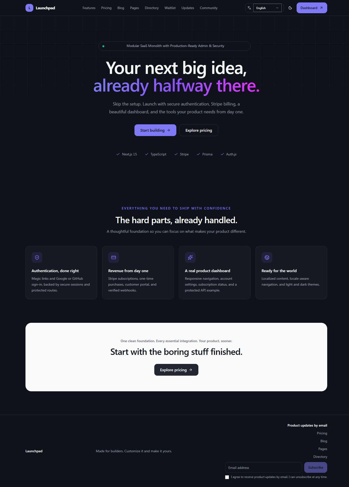
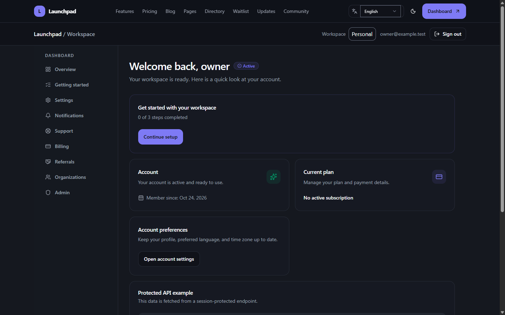
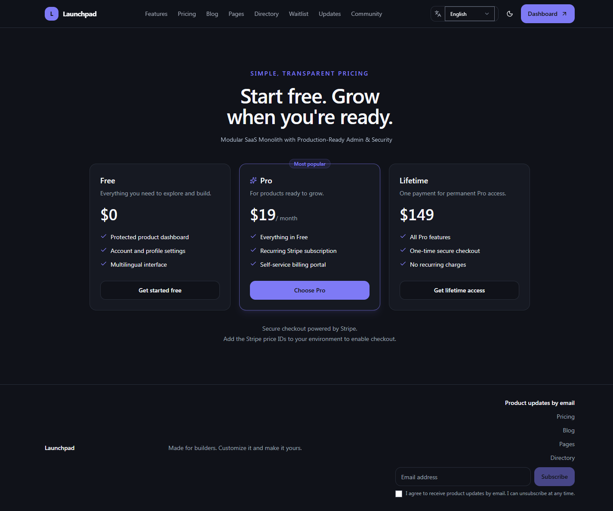
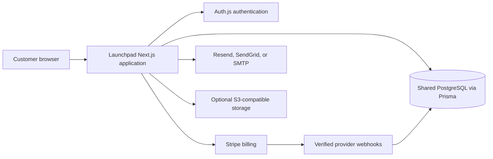

# Launchpad — Modular SaaS Monolith with Production-Ready Admin & Security

**Launch a SaaS product without assembling its core systems from scratch.**

Launchpad is a modular SaaS application: one cohesive Next.js codebase and
shared PostgreSQL data model for customer accounts, billing, administration,
content, and optional product capabilities. It is built for teams that want
control over their application and infrastructure—not a hosted service or a
collection of separately deployed services.

> Launchpad includes production-oriented administration and security
> capabilities, but it does not make a product production-ready by itself.
> You remain responsible for provider configuration, deployment hardening,
> operational monitoring, and product-specific legal and security review.

[View Launchpad on Gumroad](https://shehroz2009.gumroad.com/)

## Product preview



| Customer workspace                                    | Pricing                                       |
| ----------------------------------------------------- | --------------------------------------------- |
|  |  |

Browse the [English product screenshots](./screenshots/) or explore localized
landing and pricing pages for [all 18 locales](./docs/FEATURES.md#localization).

## What Launchpad includes

- **Customer accounts:** localized email sign-in, optional Google/GitHub OAuth,
  protected routes, TOTP multi-factor authentication, and recovery codes.
- **Billing:** Stripe subscriptions, one-time checkout, Customer Portal, signed
  webhooks, and optional Apple App Store / Google Play purchase verification.
- **Administration:** role-protected controls for users, security, analytics,
  integrations, content, support, and enabled modules.
- **Product workspace:** account settings, notifications, support, billing
  history, and optional organization and collaboration features.
- **Product capabilities:** optional modules for email campaigns, AI, publishing,
  marketing, storage, community, referrals, and more.
- **Operations:** guided first-run configuration, PostgreSQL and Prisma
  migrations, automated checks, and deployment documentation.

Provider-backed capabilities require your own provider accounts, credentials,
and configuration. The setup wizard can test selected credentials, but it does
not create accounts, complete OAuth consent, provision cloud infrastructure, or
verify every production permission.

See the [feature matrix](./docs/FEATURES.md) and the detailed
[implementation and operations guide](./docs/FEATURE-GUIDE.md) for current
scope, requirements, and limitations.

## How the application is structured



The application uses modular boundaries inside one deployable codebase.
Selected modules reuse the same application and database infrastructure;
module selection does not turn them into independent services or databases.

## Technology

| Area           | Technology                                                    |
| -------------- | ------------------------------------------------------------- |
| Application    | Next.js 16, React 19, TypeScript                              |
| Styling        | Tailwind CSS 4, reusable shadcn/ui-compatible components      |
| Authentication | Auth.js, email links, optional Google/GitHub OAuth            |
| Data           | PostgreSQL, Prisma                                            |
| Payments       | Stripe; optional Apple App Store and Google Play verification |
| Quality        | ESLint, Prettier, TypeScript checks, automated tests          |
| Deployment     | GitHub Actions checks; Vercel integration and host guides     |

## Start locally

Use Node.js 20.9 or newer (Node.js 22 LTS recommended), Docker Compose, and
PostgreSQL 14 or newer. From the project directory:

```bash
docker compose up -d
npm run setup
```

The setup wizard configures the selected modules and deployment target, gathers
settings, and offers provider checks where supported. Read the
[quickstart guide](./docs/QUICKSTART.md) before configuring a real deployment.

## Documentation

- [Quickstart and configuration](./docs/QUICKSTART.md)
- [Feature matrix and current scope](./docs/FEATURES.md)
- [Implementation and operations guide](./docs/FEATURE-GUIDE.md)
- [Vercel deployment checklist](./docs/VERCEL.md)
- [Product screenshots](./screenshots/)

## License and purchase

Launchpad is licensed software for developing and operating one product or
service. The license does not permit redistributing Launchpad or its source.
Review the included [LICENSE](./LICENSE) and the current Gumroad listing for
purchase terms, price, and availability. Launchpad is application software you
run and operate; it is not a hosted SaaS subscription.
