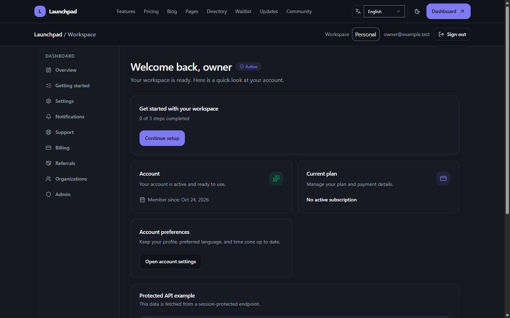
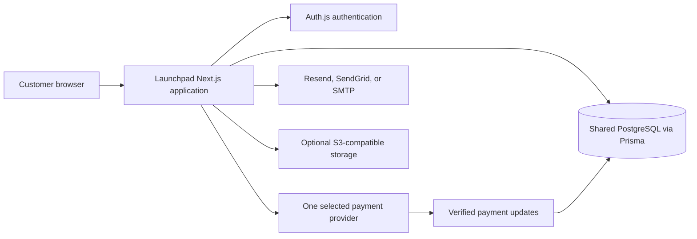

# Launchpad — A Full-Scale SaaS Foundation

**Launch a SaaS product without assembling its core systems from scratch.**

Launchpad is a full-scale SaaS product foundation: one cohesive Next.js
codebase and shared PostgreSQL data model for payments, authentication,
analytics, administration, customer workspaces, content, and optional product
capabilities. It is built for teams that want control over their application
and infrastructure—not a hosted service or a collection of separately
deployed services.

> Launchpad includes production-oriented administration and security
> capabilities, but it does not make a product production-ready by itself.
> You remain responsible for provider configuration, deployment hardening,
> operational monitoring, and product-specific legal and security review.

[View Launchpad on Gumroad](https://shehroz2009.gumroad.com/l/launchpad-full-scale-saas-foundation)

## Product preview


| Customer workspace                                    | Pricing                                       |
| ----------------------------------------------------- | --------------------------------------------- |
|  |  |

Browse the [English product screenshots](./screenshots/) or explore localized
landing and pricing pages for [all 18 locales](./docs/FEATURES.md#localization).

## What Launchpad includes

- **Customer accounts:** localized email sign-in, optional Google/GitHub OAuth,
  protected routes, TOTP multi-factor authentication, and recovery codes.
- **Billing:** choose Stripe, Paddle, Lemon Squeezy, or PayPro Global for
  subscriptions and one-time Lifetime purchases, plus optional Apple App Store
  / Google Play purchase verification. Billing events can also drive optional
  GitHub repository invitations and access removal.
- **Administration:** role-protected controls for users, security, analytics,
  integrations, content, support, and enabled modules.
- **Product workspace:** account settings, notifications, support, billing
  history, and optional organization and collaboration features.
- **Product capabilities:** optional modules for email campaigns, AI, publishing,
  marketing, storage, community, referrals, and more.
- **Operations:** first-run setup, project updates, and guided deployment to
  six targets: Vercel + Neon, Docker / Cloud VM, Fly.io, Google Cloud Run,
  AWS ECS Fargate, and Kubernetes.

Provider-backed capabilities require your own provider accounts and
credentials. The setup wizard tests selected credentials, and deployment
workflows can provision supported resources in connected accounts. They do not
create provider accounts or remove the need to prepare target-specific
prerequisites, grant consent, review costs, and verify production permissions.

See the [feature matrix](./docs/FEATURES.md) and the detailed
[implementation and operations guide](./docs/FEATURE-GUIDE.md) for current
scope, requirements, and limitations.

## How the application is structured



The application uses modular boundaries inside one deployable codebase.
Selected modules reuse the same application and database infrastructure;
module selection does not turn them into independent services or databases.

## Technology

| Area           | Technology                                                                                             |
| -------------- | ------------------------------------------------------------------------------------------------------ |
| Application    | Next.js 16, React 19, TypeScript                                                                       |
| Styling        | Tailwind CSS 4, reusable shadcn/ui-compatible components                                               |
| Authentication | Auth.js, email links, optional Google/GitHub OAuth                                                     |
| Data           | PostgreSQL, Prisma                                                                                     |
| Payments       | Stripe, Paddle, Lemon Squeezy, or PayPro Global; optional Apple App Store and Google Play verification |
| Quality        | ESLint, Prettier, TypeScript checks, automated tests                                                   |
| Deployment     | GitHub Actions checks; guided deployment to six supported targets                                      |

## Start locally

Use Git, npm, Node.js 20.19+ (or 22.13+/24+), and Docker Desktop with its
daemon running. The first-run wizard uses Docker for the local database and
email inbox.

Clone the repository and start Launchpad from the project directory:

```bash
git clone https://github.com/Shehroz2009/Launchpad.git
cd Launchpad
npm run dev
```

On first start, your browser opens the setup wizard. Choose the features and
services you want; the wizard installs their dependencies, starts the bundled
PostgreSQL and Mailpit containers, applies initial migrations, bootstraps the
administrator account, and launches the app. No separate `npm install`, `.env`
editing, or migration command is needed.

Once the app is running, use **Admin → Integrations** and **Admin → Deployment**
to configure providers and start a deployment. These workflows require your
own provider accounts and credentials; the resources created depend on the
selected target and deployment plan. See the [quickstart guide](./docs/QUICKSTART.md)
and [deployment guide](./docs/VERCEL.md) for prerequisites and limitations.

## Documentation

- [Quickstart and configuration](./docs/QUICKSTART.md)
- [Feature matrix and current scope](./docs/FEATURES.md)
- [Implementation and operations guide](./docs/FEATURE-GUIDE.md)
- [Vercel deployment checklist](./docs/VERCEL.md)
- [Product screenshots](./screenshots/)

## License and purchase

Launchpad is licensed software for developing and operating one product or
service. The license does not permit redistributing Launchpad or its source.
Launchpad is regularly updated. Current access options and purchase terms are
shown on the [Gumroad product page](https://shehroz2009.gumroad.com/l/launchpad-full-scale-saas-foundation).
Launchpad is application software you run and operate, not a hosted SaaS
service; hosting and third-party provider fees are separate. Review the
included [LICENSE](./LICENSE) for the license terms.
