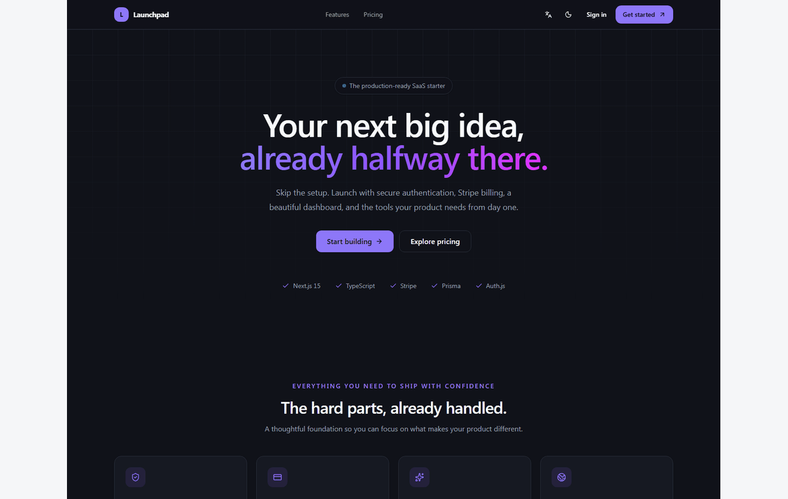
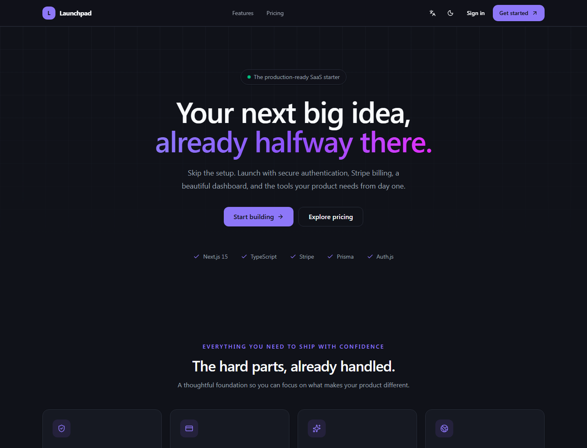
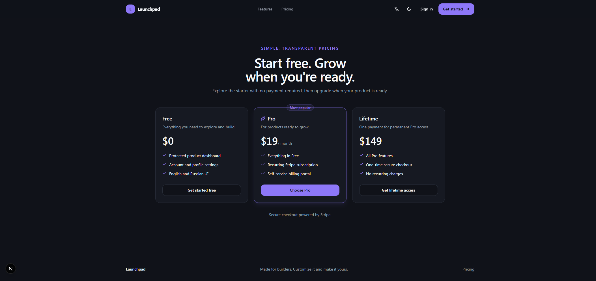
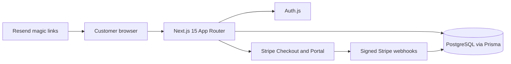

# Launchpad — Next.js SaaS Starter

**Ship your SaaS foundation, not another week of setup.**

Launchpad is a bilingual commercial starter kit for building a customer-facing
product or SaaS. It combines **Next.js 15, Prisma, PostgreSQL, and
production-minded Stripe webhook handling** with authentication, a dashboard,
and deployment guidance.

> **Want the complete source code?**  
> 👉 [Get Full Access on Gumroad](https://shehroz2009.gumroad.com/l/launchpad_saas_starter_kit)
> — $129 one-time purchase. No subscriptions. No ongoing support obligations.
> You get the current version of the starter kit.

## Preview

The tour is an animated transition between the included dashboard and pricing
screenshots; it is not a live product recording.

| Dashboard                                              | Pricing page                                       |
| ------------------------------------------------------ | -------------------------------------------------- |
|  |  |

More product screenshots and the cover image are in [`assets/`](./assets/).

## What is included

- **Next.js 15 App Router**, React 19, TypeScript, and Tailwind CSS 4.
- **Prisma and PostgreSQL**, including a schema and initial migration.
- **Stripe billing** with Checkout, Customer Portal, recurring subscriptions,
  and one-time payment synchronization.
- **Ready-to-use Stripe webhook processing** with signature verification,
  transactional event idempotency, and retryable failures.
- Auth.js sign-in with email magic links and optional Google/GitHub OAuth.
- Protected, localized dashboard, account settings, and admin tools.
- English and Russian interface, setup guides, and deployment instructions.

## Architecture at a glance

## Stack

| Area           | Technology                                        |
| -------------- | ------------------------------------------------- |
| Application    | Next.js 15, React 19, TypeScript                  |
| Styling        | Tailwind CSS 4, shadcn/ui-compatible components   |
| Authentication | Auth.js, email magic links, optional OAuth        |
| Data           | PostgreSQL, Prisma                                |
| Billing        | Stripe Checkout, Customer Portal, signed webhooks |
| Quality        | ESLint, Prettier, TypeScript checks               |
| Deployment     | Vercel-compatible Next.js deployment              |

## Quick setup overview

The purchase includes the complete source project. At a glance, the setup is:

1. Install Node.js 20.9+ and npm; provide a PostgreSQL database.
2. Create `.env` from the included `.env.example` and configure database URLs
   and an Auth.js secret.
3. Install dependencies, generate Prisma Client, and apply the database
   migrations.
4. Start the app locally; add Resend, OAuth, and Stripe credentials only for
   the integrations you want to enable.

The complete setup guide, environment-variable reference, and tested workflow
are included in the purchase. This showcase repository intentionally contains
no application source code or runnable implementation.

## Deploy to Vercel

The kit is designed for a standard Next.js deployment:

1. Provision PostgreSQL and configure pooled runtime and direct migration
   connection URLs where your provider requires them.
2. Import the purchased source project into Vercel.
3. Set required database and authentication environment variables in Vercel.
4. Apply Prisma migrations before serving traffic.
5. Configure provider callback URLs and the production Stripe webhook endpoint.
6. Verify sign-in, billing, and webhook delivery in the deployed environment.

See [`docs/VERCEL.md`](./docs/VERCEL.md) for the deployment checklist. Detailed
instructions are provided with the source kit.

## Documentation

- [Quick setup and environment guide](./docs/QUICKSTART.md)
- [Vercel deployment checklist](./docs/VERCEL.md)

## License and purchase

The public repository is a product preview, not the starter kit. It does not
include the commercial application source. The Gumroad purchase grants the
rights described in the included proprietary license: use and modify the kit
for one public-facing product or service; do not redistribute or resell the
kit or its source. The purchase is one-time, with no subscription or ongoing
support obligations; you receive the current version, and future updates are
not promised.

👉 **[Get Full Access on Gumroad](https://shehroz2009.gumroad.com/l/launchpad_saas_starter_kit)**

## Repository topics

Suggested GitHub topics: `nextjs15`, `react19`, `stripe-webhooks`, `prisma`,
`saas-starter`, `authjs-v5`.
