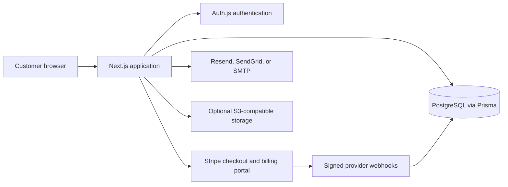

# Launchpad — Next.js SaaS Starter

**Ship your product, not another week of SaaS plumbing.**

Launchpad is a customizable, modular Next.js starter for customer-facing SaaS
products. It brings together authentication, billing, a customer dashboard,
admin tools, and a broad set of optional product modules.

> Launchpad is a commercial starter kit. The one-time purchase is for the
> current version; it does not include subscriptions, promised future updates,
> or ongoing support. See the included project license and current purchase
> terms before use.

[Get the current starter kit on Gumroad — $129 one-time](https://shehroz2009.gumroad.com/l/launchpad_saas_starter_kit)

## Preview


| Dashboard                                             | Pricing                                       |
| ----------------------------------------------------- | --------------------------------------------- |
|  |  |

Browse the [English product screenshots](./screenshots/) or see the localized
landing and pricing pages for [all 17 other locales](./docs/FEATURES.md#localization).

## What is included

- Next.js 15, React 19, TypeScript, and Tailwind CSS 4.
- PostgreSQL and Prisma, with migrations and a local Docker Compose database.
- Auth.js sign-in by email link, optional Google/GitHub OAuth, protected routes,
  TOTP multi-factor authentication, and recovery codes.
- Stripe subscriptions, one-time checkout, Customer Portal, signed webhooks,
  and Apple App Store / Google Play purchase verification.
- A responsive customer dashboard and server-authorized admin areas.
- Optional modules for analytics, email campaigns, AI, organizations,
  notifications, support, publishing, marketing, storage, and more.
- A guided project setup wizard, GitHub Actions checks, and deployment guides.

## Current capabilities

The project includes public landing and pricing pages, customer account flows,
admin tools, content publishing, product analytics, notification delivery,
security controls, and supported customization settings. Modules can be
selected during first-run setup, but the application remains a modular
monolith: selected features share the same application and database
infrastructure.

Provider-backed features require your own provider accounts, credentials, and
configuration. The setup wizard can test selected credentials, but it does not
create accounts, complete OAuth consent, provision cloud infrastructure, or
guarantee every production permission.

See the [feature matrix](./docs/FEATURES.md) and the detailed
[implementation guide](./docs/FEATURE-GUIDE.md) for the exact current scope,
requirements, and limitations.

## Architecture at a glance



## Stack

| Area           | Technology                                                    |
| -------------- | ------------------------------------------------------------- |
| Application    | Next.js 15, React 19, TypeScript                              |
| Styling        | Tailwind CSS 4, reusable shadcn/ui-compatible components      |
| Authentication | Auth.js, email links, optional Google/GitHub OAuth            |
| Data           | PostgreSQL, Prisma                                            |
| Payments       | Stripe; optional Apple App Store and Google Play verification |
| Quality        | ESLint, Prettier, TypeScript checks, automated tests          |
| Deployment     | GitHub Actions checks; Vercel integration and host guides     |

## Quick start

Use Node.js 20.9 or newer (Node.js 22 LTS recommended), Docker Compose, and
PostgreSQL 14 or newer. From a clean project archive or checkout, start the
local database if using Docker, then run:

```bash
docker compose up -d
npm run setup
```

The setup wizard selects modules and deployment target, collects settings, and
offers provider checks where supported. Read the full
[quickstart guide](./docs/QUICKSTART.md) before configuring a real deployment.

## Documentation

- [Quickstart and configuration](./docs/QUICKSTART.md)
- [Feature matrix and current scope](./docs/FEATURES.md)
- [Full implementation and operations guide](./docs/FEATURE-GUIDE.md)
- [Vercel deployment checklist](./docs/VERCEL.md)
- [Screenshots](./screenshots/)

## License and purchase

The project is a commercial starter kit, not a hosted SaaS subscription.
Purchase terms and permitted use are defined by the included
[LICENSE](./LICENSE). The current version is provided as a one-time purchase;
ongoing support and future updates are not promised.
