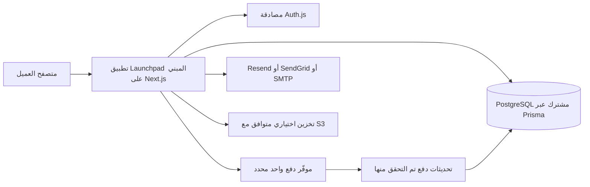

# Launchpad — أساس شامل لمنتجات SaaS

**أطلق منتج SaaS دون تجميع أنظمته الأساسية من الصفر.**

Launchpad أساس متكامل لمنتجات SaaS: قاعدة شيفرة Next.js موحّدة ونموذج بيانات
PostgreSQL مشترك للمدفوعات والمصادقة والتحليلات والإدارة ومساحات عمل العملاء
والمحتوى والقدرات الاختيارية للمنتج. صُمم للفرق التي تريد التحكم في تطبيقها
وبنيتها التحتية، لا الاعتماد على خدمة مستضافة أو مجموعة خدمات تُنشر كل منها
على حدة.

> يتضمن Launchpad إمكانات إدارية وأمنية موجهة لبيئات الإنتاج، لكنه لا يجعل
> المنتج جاهزًا للإنتاج بمفرده. تظل مسؤولًا عن إعداد الموفّرين وتعزيز أمان
> النشر والمراقبة التشغيلية والمراجعات القانونية والأمنية الخاصة بمنتجك.

[اطّلع على Launchpad في Gumroad](https://shehroz2009.gumroad.com/l/launchpad-full-scale-saas-foundation)

اقرأ ملف README هذا بلغات أخرى:
[বাংলা](./README.bn.md) · [Deutsch](./README.de.md) · [Español](./README.es.md) ·
[Français](./README.fr.md) · [हिन्दी](./README.hi.md) · [Bahasa Indonesia](./README.id.md) ·
[Italiano](./README.it.md) · [日本語](./README.ja.md) · [한국어](./README.ko.md) ·
[Nederlands](./README.nl.md) · [Polski](./README.pl.md) · [Português](./README.pt.md) ·
[Русский](./README.ru.md) · [Türkçe](./README.tr.md) · [Tiếng Việt](./README.vi.md) ·
[简体中文](./README.zh.md) · [English](../README.md)

## معاينة المنتج


| مساحة عمل العميل | صفحة الأسعار |
| ---------------- | ------------ |
|  |  |

تصفّح [لقطات شاشة المنتج باللغة الإنجليزية](../screenshots/) أو استكشف صفحات
الصفحة الرئيسية والأسعار المترجمة إلى [اللغات الثماني عشرة](../docs/FEATURES.md#localization).

## ما الذي يتضمنه Launchpad

- **حسابات العملاء:** تسجيل دخول بالبريد الإلكتروني مترجم، وOAuth اختياري عبر
  Google/GitHub، ومسارات محمية، ومصادقة متعددة العوامل TOTP، ورموز استرداد.
- **الفوترة:** اشتراكات ومشتريات Lifetime لمرة واحدة عبر Stripe أو Paddle أو
  Lemon Squeezy أو PayPro Global، إضافة إلى التحقق الاختياري من مشتريات Apple
  App Store / Google Play. ويمكن لأحداث الفوترة أيضًا إدارة دعوات اختيارية إلى
  مستودعات GitHub الخاصة وسحب صلاحية الوصول.
- **الإدارة:** أدوات محمية بالأدوار لإدارة المستخدمين والأمان والتحليلات
  والتكاملات والمحتوى والدعم والوحدات المفعّلة.
- **مساحة عمل المنتج:** إعدادات الحساب والإشعارات والدعم وسجل الفوترة
  والميزات الاختيارية للمؤسسات والتعاون.
- **قدرات المنتج:** وحدات اختيارية لحملات البريد الإلكتروني والذكاء الاصطناعي
  والنشر والتسويق والتخزين والمجتمع والإحالات وغيرها.
- **العمليات:** الإعداد الأولي وتحديث المشاريع والنشر الموجّه إلى ستة أهداف:
  Vercel + Neon وDocker / آلة افتراضية سحابية وFly.io وGoogle Cloud Run
  وAWS ECS Fargate وKubernetes.

تتطلب الإمكانات المعتمدة على الموفّرين حساباتك وبيانات اعتمادك وإعداداتك الخاصة.
يختبر معالج الإعداد بيانات الاعتماد المحددة، ويمكن لسير عمل النشر توفير الموارد
المدعومة في الحسابات المتصلة. لا تنشئ هذه المسارات حسابات الموفّرين ولا تُغني
عن إعداد متطلبات المنصة المستهدفة ومنح الموافقات ومراجعة التكاليف والتحقق من
صلاحيات الإنتاج.

راجع [مصفوفة الميزات](../docs/FEATURES.md) و[دليل التنفيذ والعمليات المفصل](../docs/FEATURE-GUIDE.md)
للاطلاع على النطاق والمتطلبات والقيود الحالية.

## بنية التطبيق



يستخدم التطبيق حدودًا معيارية ضمن قاعدة شيفرة واحدة قابلة للنشر. تعيد الوحدات
المحددة استخدام البنية التحتية نفسها للتطبيق وقاعدة البيانات؛ ولا يحوّلها
اختيار الوحدات إلى خدمات أو قواعد بيانات مستقلة.

## التقنيات

| المجال | التقنية |
| ------ | ------- |
| التطبيق | Next.js 16 وReact 19 وTypeScript |
| التنسيق | Tailwind CSS 4 ومكونات قابلة لإعادة الاستخدام ومتوافقة مع shadcn/ui |
| المصادقة | Auth.js وروابط البريد الإلكتروني وOAuth اختياري عبر Google/GitHub |
| البيانات | PostgreSQL وPrisma |
| المدفوعات | Stripe أو Paddle أو Lemon Squeezy أو PayPro Global؛ والتحقق الاختياري عبر Apple App Store وGoogle Play |
| الجودة | ESLint وPrettier وفحوص TypeScript واختبارات آلية |
| النشر | فحوص GitHub Actions ونشر موجّه إلى ستة أهداف مدعومة |

## التشغيل محليًا

تحتاج إلى Git وnpm وNode.js 20.19+ (أو 22.13+/24+) وإلى Docker Desktop
قيد التشغيل مع عمل الخدمة الخلفية. يستخدم معالج التشغيل الأول Docker لقاعدة
البيانات المحلية وصندوق البريد التجريبي.

استنسخ المستودع وشغّل Launchpad من مجلد المشروع:

```bash
git clone https://github.com/Shehroz2009/Launchpad.git
cd Launchpad
npm run dev
```

عند التشغيل لأول مرة، يفتح المتصفح معالج الإعداد. اختر الميزات والخدمات التي
تريدها؛ فيثبّت المعالج تبعياتها ويشغّل حاويتي PostgreSQL وMailpit المرفقتين،
ويطبّق عمليات الترحيل الأولية، وينشئ حساب المسؤول، ثم يشغّل التطبيق. لا حاجة
إلى تنفيذ `npm install` منفصل أو تعديل `.env` أو تشغيل أمر للترحيل.

بعد تشغيل التطبيق، استخدم **Admin → Integrations** و**Admin → Deployment**
لإعداد الموفّرين وبدء النشر. تتطلب هذه المسارات حساباتك وبيانات اعتمادك؛
وتعتمد الموارد المنشأة على الهدف وخطة النشر المحددين. راجع
[دليل البدء السريع](../docs/QUICKSTART.md) و[دليل النشر](../docs/VERCEL.md)
للمتطلبات والقيود.

## الوثائق

- [البدء السريع والإعداد](../docs/QUICKSTART.md)
- [مصفوفة الميزات والنطاق الحالي](../docs/FEATURES.md)
- [دليل التنفيذ والعمليات](../docs/FEATURE-GUIDE.md)
- [قائمة التحقق من النشر على Vercel](../docs/VERCEL.md)
- [لقطات شاشة المنتج](../screenshots/)

## الترخيص والشراء

Launchpad برنامج مرخّص لتطوير منتج أو خدمة واحدة وتشغيلها. لا يسمح الترخيص
بإعادة توزيع Launchpad أو شيفرته المصدرية. يتلقى Launchpad تحديثات بانتظام.
تجد خيارات الوصول وشروط الشراء الحالية في
[صفحة المنتج على Gumroad](https://shehroz2009.gumroad.com/l/launchpad-full-scale-saas-foundation).
Launchpad برنامج تطبيقي تستضيفه وتشغّله بنفسك، وليس خدمة SaaS مستضافة؛ وتُحتسب
رسوم الاستضافة والموفّرين الخارجيين بشكل منفصل. راجع شروط الترخيص في
[ملف LICENSE](../LICENSE).
