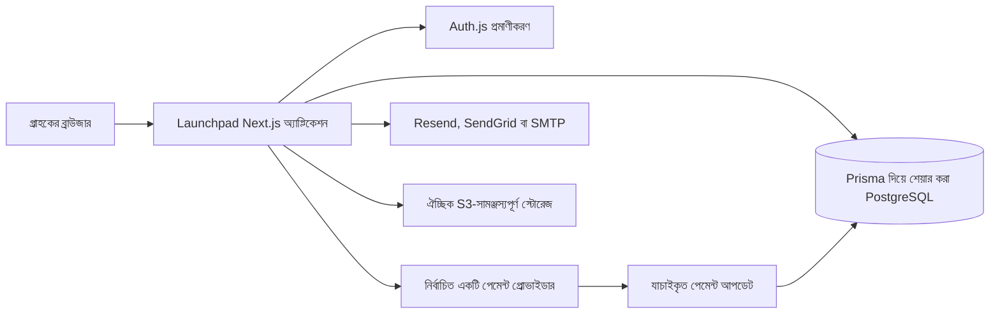

# Launchpad — পূর্ণাঙ্গ SaaS পণ্যের ভিত্তি

**মূল সিস্টেমগুলো শূন্য থেকে জোড়া না লাগিয়েই SaaS পণ্য চালু করুন।**

Launchpad একটি পূর্ণাঙ্গ SaaS পণ্যের ভিত্তি: পেমেন্ট, প্রমাণীকরণ, অ্যানালিটিক্স,
প্রশাসন, গ্রাহক কর্মক্ষেত্র, কনটেন্ট এবং ঐচ্ছিক পণ্য-সুবিধার জন্য একটি একীভূত
Next.js কোডবেস ও শেয়ার করা PostgreSQL ডেটা মডেল। এটি এমন দলগুলোর জন্য তৈরি,
যারা হোস্টেড সার্ভিস বা আলাদাভাবে ডিপ্লয় করা সার্ভিসের সমষ্টির বদলে নিজেদের
অ্যাপ্লিকেশন ও অবকাঠামোর নিয়ন্ত্রণ রাখতে চায়।

> Launchpad-এ প্রোডাকশনের জন্য উপযোগী প্রশাসনিক ও নিরাপত্তা সুবিধা রয়েছে,
> তবে এটি একাই কোনো পণ্যকে প্রোডাকশন-প্রস্তুত করে না। প্রোভাইডার কনফিগারেশন,
> ডিপ্লয়মেন্টের নিরাপত্তা জোরদার করা, অপারেশনাল মনিটরিং এবং পণ্য-নির্দিষ্ট
> আইনি ও নিরাপত্তা পর্যালোচনার দায়িত্ব আপনার।

[Gumroad-এ Launchpad দেখুন](https://shehroz2009.gumroad.com/l/launchpad-full-scale-saas-foundation)

এই README অন্য ভাষায় পড়ুন:
[العربية](./README.ar.md) · [Deutsch](./README.de.md) · [Español](./README.es.md) ·
[Français](./README.fr.md) · [हिन्दी](./README.hi.md) · [Bahasa Indonesia](./README.id.md) ·
[Italiano](./README.it.md) · [日本語](./README.ja.md) · [한국어](./README.ko.md) ·
[Nederlands](./README.nl.md) · [Polski](./README.pl.md) · [Português](./README.pt.md) ·
[Русский](./README.ru.md) · [Türkçe](./README.tr.md) · [Tiếng Việt](./README.vi.md) ·
[简体中文](./README.zh.md) · [English](../README.md)

## পণ্যের পূর্বরূপ


| গ্রাহক কর্মক্ষেত্র | মূল্য নির্ধারণের পৃষ্ঠা |
| ------------------ | ----------------------- |
|  |  |

[ইংরেজি পণ্যের স্ক্রিনশট](../screenshots/) দেখুন অথবা
[সব ১৮টি লোকেলে](../docs/FEATURES.md#localization) স্থানীয়কৃত ল্যান্ডিং ও
মূল্য নির্ধারণের পৃষ্ঠা ঘুরে দেখুন।

## Launchpad-এ যা রয়েছে

- **গ্রাহক অ্যাকাউন্ট:** স্থানীয়কৃত ইমেইল সাইন-ইন, ঐচ্ছিক Google/GitHub OAuth,
  সুরক্ষিত রুট, TOTP বহুধাপ প্রমাণীকরণ এবং পুনরুদ্ধার কোড।
- **বিলিং:** Stripe, Paddle, Lemon Squeezy বা PayPro Global দিয়ে সাবস্ক্রিপশন
  এবং এককালীন Lifetime কেনাকাটা; পাশাপাশি ঐচ্ছিক Apple App Store / Google Play
  কেনাকাটা যাচাই। বিলিং ইভেন্ট ঐচ্ছিক GitHub ব্যক্তিগত রিপোজিটরির আমন্ত্রণ ও
  অ্যাক্সেস প্রত্যাহারও পরিচালনা করতে পারে।
- **প্রশাসন:** ব্যবহারকারী, নিরাপত্তা, অ্যানালিটিক্স, ইন্টিগ্রেশন, কনটেন্ট,
  সহায়তা এবং চালু করা মডিউলের জন্য ভূমিকা-সুরক্ষিত নিয়ন্ত্রণ।
- **পণ্য কর্মক্ষেত্র:** অ্যাকাউন্ট সেটিংস, বিজ্ঞপ্তি, সহায়তা, বিলিং ইতিহাস
  এবং ঐচ্ছিক প্রতিষ্ঠান ও সহযোগিতা সুবিধা।
- **পণ্য সক্ষমতা:** ইমেইল ক্যাম্পেইন, AI, প্রকাশনা, মার্কেটিং, স্টোরেজ,
  কমিউনিটি, রেফারেল ও আরও কিছুর জন্য ঐচ্ছিক মডিউল।
- **অপারেশন:** প্রথমবারের সেটআপ, প্রকল্প আপডেট এবং ছয়টি লক্ষ্যে নির্দেশিত
  ডিপ্লয়মেন্ট: Vercel + Neon, Docker / Cloud VM, Fly.io, Google Cloud Run,
  AWS ECS Fargate এবং Kubernetes।

প্রোভাইডার-নির্ভর সুবিধার জন্য আপনার নিজস্ব প্রোভাইডার অ্যাকাউন্ট, ক্রেডেনশিয়াল
ও কনফিগারেশন দরকার। সেটআপ উইজার্ড নির্বাচিত ক্রেডেনশিয়াল পরীক্ষা করে এবং
ডিপ্লয়মেন্ট ওয়ার্কফ্লো সংযুক্ত অ্যাকাউন্টে সমর্থিত রিসোর্স তৈরি করতে পারে।
এগুলো প্রোভাইডার অ্যাকাউন্ট তৈরি করে না; লক্ষ্য প্ল্যাটফর্মের পূর্বশর্ত প্রস্তুত
করা, সম্মতি দেওয়া, খরচ পর্যালোচনা এবং প্রোডাকশন অনুমতি যাচাই করার দায়িত্ব
আপনারই থাকে।

বর্তমান পরিধি, প্রয়োজনীয়তা ও সীমাবদ্ধতা জানতে [ফিচার ম্যাট্রিক্স](../docs/FEATURES.md)
এবং বিস্তারিত [বাস্তবায়ন ও অপারেশনস গাইড](../docs/FEATURE-GUIDE.md) দেখুন।

## অ্যাপ্লিকেশনের কাঠামো



অ্যাপ্লিকেশনটি একটি ডিপ্লয়যোগ্য কোডবেসের ভেতরে মডিউলার সীমানা ব্যবহার করে।
নির্বাচিত মডিউল একই অ্যাপ্লিকেশন ও ডেটাবেস অবকাঠামো পুনর্ব্যবহার করে; মডিউল
নির্বাচন এগুলোকে স্বাধীন সার্ভিস বা ডেটাবেসে পরিণত করে না।

## প্রযুক্তি

| ক্ষেত্র | প্রযুক্তি |
| ------ | -------- |
| অ্যাপ্লিকেশন | Next.js 16, React 19, TypeScript |
| স্টাইলিং | Tailwind CSS 4, পুনর্ব্যবহারযোগ্য shadcn/ui-সামঞ্জস্যপূর্ণ কম্পোনেন্ট |
| প্রমাণীকরণ | Auth.js, ইমেইল লিংক, ঐচ্ছিক Google/GitHub OAuth |
| ডেটা | PostgreSQL, Prisma |
| পেমেন্ট | Stripe, Paddle, Lemon Squeezy বা PayPro Global; ঐচ্ছিক Apple App Store ও Google Play যাচাই |
| গুণমান | ESLint, Prettier, TypeScript পরীক্ষা, স্বয়ংক্রিয় টেস্ট |
| ডিপ্লয়মেন্ট | GitHub Actions পরীক্ষা; ছয়টি সমর্থিত লক্ষ্যে নির্দেশিত ডিপ্লয়মেন্ট |

## স্থানীয়ভাবে শুরু করুন

আপনার Git, npm, Node.js 20.19+ (অথবা 22.13+/24+) এবং চালু daemon-সহ
Docker Desktop প্রয়োজন। প্রথমবারের উইজার্ড স্থানীয় ডেটাবেস ও ইমেইল ইনবক্সের
জন্য Docker ব্যবহার করে।

রিপোজিটরি ক্লোন করে প্রকল্প ডিরেক্টরি থেকে Launchpad চালু করুন:

```bash
git clone https://github.com/Shehroz2009/Launchpad.git
cd Launchpad
npm run dev
```

প্রথমবার চালালে ব্রাউজারে সেটআপ উইজার্ড খুলবে। প্রয়োজনীয় ফিচার ও সার্ভিস
বেছে নিন; উইজার্ড নির্বাচিত নির্ভরতা ইনস্টল করে, অন্তর্ভুক্ত PostgreSQL ও
Mailpit কনটেইনার চালু করে, প্রাথমিক মাইগ্রেশন প্রয়োগ করে, অ্যাডমিন
অ্যাকাউন্ট তৈরি করে এবং অ্যাপ্লিকেশন চালু করে। আলাদা করে `npm install`
চালানো, `.env` সম্পাদনা বা মাইগ্রেশন কমান্ড চালানোর দরকার নেই।

অ্যাপ্লিকেশন চালু হলে প্রোভাইডার কনফিগার ও ডিপ্লয়মেন্ট শুরু করতে
**Admin → Integrations** এবং **Admin → Deployment** ব্যবহার করুন। এসব
ওয়ার্কফ্লোর জন্য আপনার নিজস্ব প্রোভাইডার অ্যাকাউন্ট ও ক্রেডেনশিয়াল দরকার;
তৈরি হওয়া রিসোর্স নির্বাচিত লক্ষ্য ও ডিপ্লয়মেন্ট পরিকল্পনার ওপর নির্ভর করে।
পূর্বশর্ত ও সীমাবদ্ধতার জন্য [দ্রুত শুরু গাইড](../docs/QUICKSTART.md) এবং
[ডিপ্লয়মেন্ট গাইড](../docs/VERCEL.md) দেখুন।

## ডকুমেন্টেশন

- [দ্রুত শুরু ও কনফিগারেশন](../docs/QUICKSTART.md)
- [ফিচার ম্যাট্রিক্স ও বর্তমান পরিধি](../docs/FEATURES.md)
- [বাস্তবায়ন ও অপারেশনস গাইড](../docs/FEATURE-GUIDE.md)
- [Vercel ডিপ্লয়মেন্ট চেকলিস্ট](../docs/VERCEL.md)
- [পণ্যের স্ক্রিনশট](../screenshots/)

## লাইসেন্স ও ক্রয়

Launchpad একটি পণ্য বা সার্ভিস তৈরি ও পরিচালনার জন্য লাইসেন্সকৃত সফটওয়্যার।
লাইসেন্স Launchpad বা এর সোর্স কোড পুনর্বিতরণ করার অনুমতি দেয় না। Launchpad
নিয়মিত আপডেট হয়। বর্তমান অ্যাক্সেসের বিকল্প ও ক্রয়ের শর্তাবলি
[Gumroad পণ্য পৃষ্ঠায়](https://shehroz2009.gumroad.com/l/launchpad-full-scale-saas-foundation)
দেওয়া আছে। Launchpad এমন একটি অ্যাপ্লিকেশন সফটওয়্যার যা আপনি নিজে হোস্ট ও
পরিচালনা করেন—এটি হোস্টেড SaaS সার্ভিস নয়; হোস্টিং ও তৃতীয় পক্ষের
প্রোভাইডারের ফি আলাদা। লাইসেন্সের শর্তাবলি সংযুক্ত [LICENSE](../LICENSE)
ফাইলে দেখুন।
