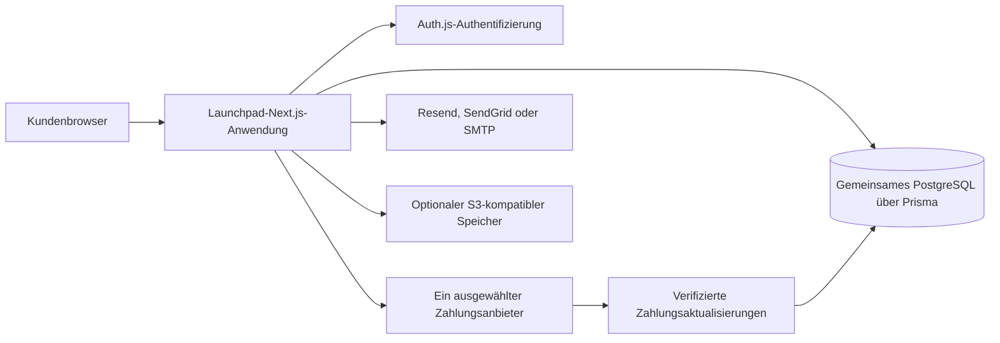

# Launchpad — eine umfassende Grundlage für SaaS-Produkte

**Starte ein SaaS-Produkt, ohne die Kernsysteme von Grund auf selbst zusammenzustellen.**

Launchpad ist eine umfassende Grundlage für SaaS-Produkte: eine gemeinsame
Next.js-Codebasis und ein gemeinsames PostgreSQL-Datenmodell für Zahlungen,
Authentifizierung, Analysen, Administration, Kundenarbeitsbereiche, Inhalte
und optionale Produktfunktionen. Es richtet sich an Teams, die die Kontrolle
über ihre Anwendung und Infrastruktur behalten möchten – statt einen
gehosteten Dienst oder eine Sammlung separat bereitgestellter Services zu
verwenden.

> Launchpad enthält produktionsorientierte Verwaltungs- und
> Sicherheitsfunktionen, macht ein Produkt aber nicht automatisch
> produktionsbereit. Du bist weiterhin für die Anbieterkonfiguration, die
> Absicherung der Bereitstellung, die Betriebsüberwachung sowie die
> produktspezifische rechtliche und sicherheitsbezogene Prüfung verantwortlich.

[Launchpad auf Gumroad ansehen](https://shehroz2009.gumroad.com/l/launchpad-full-scale-saas-foundation)

Lies diese README in einer anderen Sprache:
[العربية](./README.ar.md) · [বাংলা](./README.bn.md) · [Español](./README.es.md) ·
[Français](./README.fr.md) · [हिन्दी](./README.hi.md) · [Bahasa Indonesia](./README.id.md) ·
[Italiano](./README.it.md) · [日本語](./README.ja.md) · [한국어](./README.ko.md) ·
[Nederlands](./README.nl.md) · [Polski](./README.pl.md) · [Português](./README.pt.md) ·
[Русский](./README.ru.md) · [Türkçe](./README.tr.md) · [Tiếng Việt](./README.vi.md) ·
[简体中文](./README.zh.md) · [English](../README.md)

## Produktvorschau


| Kundenarbeitsbereich | Preisseite |
| -------------------- | ---------- |
|  |  |

Sieh dir die [englischen Produkt-Screenshots](../screenshots/) an oder entdecke
lokalisierte Landingpages und Preisseiten für [alle 18 Sprachen](../docs/FEATURES.md#localization).

## Was Launchpad enthält

- **Kundenkonten:** lokalisierte Anmeldung per E-Mail, optionales Google-/
  GitHub-OAuth, geschützte Routen, TOTP-Mehrfaktor-Authentifizierung und
  Wiederherstellungscodes.
- **Abrechnung:** Abonnements und einmalige Lifetime-Käufe über Stripe,
  Paddle, Lemon Squeezy oder PayPro Global sowie optionale Kaufverifizierung
  für Apple App Store / Google Play. Abrechnungsereignisse können außerdem
  optionale Einladungen zu privaten GitHub-Repositories und den Entzug des
  Zugriffs steuern.
- **Administration:** rollenbasierte Verwaltungsfunktionen für Benutzer,
  Sicherheit, Analysen, Integrationen, Inhalte, Support und aktivierte Module.
- **Produktarbeitsbereich:** Kontoeinstellungen, Benachrichtigungen, Support,
  Abrechnungshistorie sowie optionale Organisations- und Kollaborationsfunktionen.
- **Produktfunktionen:** optionale Module für E-Mail-Kampagnen, KI,
  Veröffentlichungen, Marketing, Speicher, Community, Empfehlungen und mehr.
- **Betrieb:** Ersteinrichtung, Projektaktualisierungen und geführte
  Bereitstellung auf sechs Zielen: Vercel + Neon, Docker / Cloud-VM, Fly.io,
  Google Cloud Run, AWS ECS Fargate und Kubernetes.

Für anbieterabhängige Funktionen benötigst du eigene Anbieterkonten,
Zugangsdaten und Konfigurationen. Der Einrichtungsassistent testet ausgewählte
Zugangsdaten; Bereitstellungsworkflows können unterstützte Ressourcen in
verbundenen Konten bereitstellen. Sie erstellen keine Anbieterkonten und
ersetzen nicht die Vorbereitung zielplattform-spezifischer Voraussetzungen,
die Erteilung von Zustimmungen, die Prüfung der Kosten oder die Überprüfung
von Produktionsberechtigungen.

Den aktuellen Umfang, die Anforderungen und Einschränkungen findest du in der
[Funktionsübersicht](../docs/FEATURES.md) und im ausführlichen
[Implementierungs- und Betriebshandbuch](../docs/FEATURE-GUIDE.md).

## Aufbau der Anwendung



Die Anwendung verwendet modulare Grenzen innerhalb einer einzigen
bereitstellbaren Codebasis. Ausgewählte Module nutzen dieselbe Anwendungs-
und Datenbankinfrastruktur; durch die Modulauswahl entstehen keine unabhängigen
Services oder Datenbanken.

## Technologie

| Bereich | Technologie |
| ------- | ----------- |
| Anwendung | Next.js 16, React 19, TypeScript |
| Styling | Tailwind CSS 4, wiederverwendbare shadcn/ui-kompatible Komponenten |
| Authentifizierung | Auth.js, E-Mail-Links, optionales Google-/GitHub-OAuth |
| Daten | PostgreSQL, Prisma |
| Zahlungen | Stripe, Paddle, Lemon Squeezy oder PayPro Global; optionale Verifizierung über Apple App Store und Google Play |
| Qualität | ESLint, Prettier, TypeScript-Prüfungen, automatisierte Tests |
| Bereitstellung | GitHub-Actions-Prüfungen; geführte Bereitstellung auf sechs unterstützten Zielen |

## Lokal starten

Du benötigst Git, npm, Node.js 20.19+ (oder 22.13+/24+) und Docker Desktop
mit laufendem Daemon. Der Assistent für den ersten Start verwendet Docker für
die lokale Datenbank und das E-Mail-Testpostfach.

Klone das Repository und starte Launchpad im Projektverzeichnis:

```bash
git clone https://github.com/Shehroz2009/Launchpad.git
cd Launchpad
npm run dev
```

Beim ersten Start öffnet sich der Einrichtungsassistent im Browser. Wähle die
gewünschten Funktionen und Services aus. Der Assistent installiert die
zugehörigen Abhängigkeiten, startet die enthaltenen PostgreSQL- und
Mailpit-Container, führt die ersten Migrationen aus, richtet das
Administratorkonto ein und startet die Anwendung. Ein separates
`npm install`, eine Bearbeitung der `.env`-Datei oder ein Migrationsbefehl
ist nicht erforderlich.

Öffne in der laufenden Anwendung **Admin → Integrationen** und
**Admin → Bereitstellung**, um Anbieter zu konfigurieren und eine Bereitstellung
zu starten. Diese Workflows erfordern eigene Anbieterkonten und Zugangsdaten;
die erstellten Ressourcen hängen vom gewählten Ziel und Bereitstellungsplan ab.
Voraussetzungen und Einschränkungen findest du in der
[Schnellstartanleitung](../docs/QUICKSTART.md) und im
[Bereitstellungshandbuch](../docs/VERCEL.md).

## Dokumentation

- [Schnellstart und Konfiguration](../docs/QUICKSTART.md)
- [Funktionsübersicht und aktueller Umfang](../docs/FEATURES.md)
- [Implementierungs- und Betriebshandbuch](../docs/FEATURE-GUIDE.md)
- [Vercel-Bereitstellungscheckliste](../docs/VERCEL.md)
- [Produkt-Screenshots](../screenshots/)

## Lizenz und Kauf

Launchpad ist lizenzierte Software zur Entwicklung und zum Betrieb eines
Produkts oder Services. Die Lizenz erlaubt nicht, Launchpad oder dessen
Quellcode weiterzuverbreiten. Launchpad wird regelmäßig aktualisiert. Aktuelle
Zugangsoptionen und Kaufbedingungen findest du auf der
[Gumroad-Produktseite](https://shehroz2009.gumroad.com/l/launchpad-full-scale-saas-foundation).
Launchpad ist Anwendungssoftware, die du selbst hostest und betreibst, kein
gehosteter SaaS-Dienst; Hosting- und Drittanbietergebühren fallen separat an.
Die Lizenzbedingungen stehen in der enthaltenen [LICENSE](../LICENSE).
