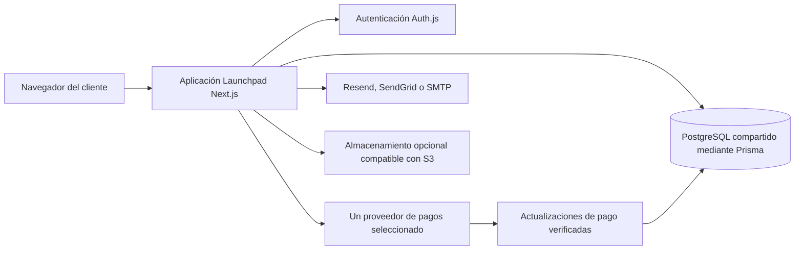

# Launchpad — una base integral para productos SaaS

**Lanza un producto SaaS sin tener que ensamblar sus sistemas principales desde cero.**

Launchpad es una base integral para productos SaaS: una única base de código
Next.js y un modelo de datos PostgreSQL compartido para pagos, autenticación,
analítica, administración, espacios de trabajo de clientes, contenido y
capacidades opcionales. Está pensado para equipos que quieren controlar su
aplicación y su infraestructura, en lugar de depender de un servicio alojado o
de varios servicios desplegados por separado.

> Launchpad incluye funciones administrativas y de seguridad orientadas a
> producción, pero no convierte por sí solo un producto en algo listo para
> producción. Sigues siendo responsable de configurar los proveedores,
> reforzar la seguridad del despliegue, supervisar las operaciones y realizar
> las revisiones legales y de seguridad específicas de tu producto.

[Ver Launchpad en Gumroad](https://shehroz2009.gumroad.com/l/launchpad-full-scale-saas-foundation)

Lee este README en otro idioma:
[العربية](./README.ar.md) · [বাংলা](./README.bn.md) · [Deutsch](./README.de.md) ·
[Français](./README.fr.md) · [हिन्दी](./README.hi.md) · [Bahasa Indonesia](./README.id.md) ·
[Italiano](./README.it.md) · [日本語](./README.ja.md) · [한국어](./README.ko.md) ·
[Nederlands](./README.nl.md) · [Polski](./README.pl.md) · [Português](./README.pt.md) ·
[Русский](./README.ru.md) · [Türkçe](./README.tr.md) · [Tiếng Việt](./README.vi.md) ·
[简体中文](./README.zh.md) · [English](../README.md)

## Vista previa del producto


| Espacio de trabajo del cliente | Página de precios |
| ------------------------------- | ----------------- |
|  |  |

Explora las [capturas de pantalla del producto en inglés](../screenshots/) o
las páginas localizadas de presentación y precios para [los 18 idiomas](../docs/FEATURES.md#localization).

## Qué incluye Launchpad

- **Cuentas de clientes:** inicio de sesión por correo electrónico localizado,
  OAuth opcional de Google/GitHub, rutas protegidas, autenticación multifactor
  TOTP y códigos de recuperación.
- **Facturación:** suscripciones y compras únicas Lifetime con Stripe, Paddle,
  Lemon Squeezy o PayPro Global, además de verificación opcional de compras de
  Apple App Store / Google Play. Los eventos de facturación también pueden
  gestionar invitaciones opcionales a repositorios privados de GitHub y retirar
  el acceso.
- **Administración:** controles protegidos por roles para usuarios, seguridad,
  analítica, integraciones, contenido, soporte y módulos habilitados.
- **Espacio de trabajo del producto:** ajustes de cuenta, notificaciones,
  soporte, historial de facturación y funciones opcionales de organizaciones y
  colaboración.
- **Capacidades del producto:** módulos opcionales para campañas de correo,
  IA, publicación, marketing, almacenamiento, comunidad, referidos y más.
- **Operaciones:** configuración inicial, actualizaciones del proyecto y
  despliegue guiado en seis destinos: Vercel + Neon, Docker / VM en la nube,
  Fly.io, Google Cloud Run, AWS ECS Fargate y Kubernetes.

Las capacidades que dependen de proveedores requieren tus propias cuentas,
credenciales y configuración. El asistente de configuración prueba las
credenciales seleccionadas, y los flujos de despliegue pueden aprovisionar
recursos compatibles en cuentas conectadas. No crean cuentas de proveedores y
no eliminan la necesidad de preparar los requisitos previos del destino,
conceder permisos, revisar costes y verificar los permisos de producción.

Consulta la [matriz de funciones](../docs/FEATURES.md) y la detallada
[guía de implementación y operaciones](../docs/FEATURE-GUIDE.md) para conocer
el alcance, los requisitos y las limitaciones actuales.

## Estructura de la aplicación



La aplicación utiliza límites modulares dentro de una única base de código
desplegable. Los módulos seleccionados reutilizan la misma infraestructura de
aplicación y base de datos; la selección de módulos no los convierte en
servicios ni bases de datos independientes.

## Tecnología

| Área | Tecnología |
| ---- | ---------- |
| Aplicación | Next.js 16, React 19, TypeScript |
| Estilos | Tailwind CSS 4, componentes reutilizables compatibles con shadcn/ui |
| Autenticación | Auth.js, enlaces por correo, OAuth opcional de Google/GitHub |
| Datos | PostgreSQL, Prisma |
| Pagos | Stripe, Paddle, Lemon Squeezy o PayPro Global; verificación opcional de Apple App Store y Google Play |
| Calidad | ESLint, Prettier, comprobaciones de TypeScript, pruebas automatizadas |
| Despliegue | Comprobaciones de GitHub Actions; despliegue guiado en seis destinos compatibles |

## Iniciar localmente

Necesitas Git, npm, Node.js 20.19+ (o 22.13+/24+) y Docker Desktop en
ejecución con su daemon activo. El asistente de primer inicio utiliza Docker
para la base de datos local y el buzón de correo.

Clona el repositorio e inicia Launchpad desde el directorio del proyecto:

```bash
git clone https://github.com/Shehroz2009/Launchpad.git
cd Launchpad
npm run dev
```

En el primer inicio, el navegador abre el asistente de configuración. Elige
las funciones y los servicios que necesites; el asistente instala sus
dependencias, inicia los contenedores incluidos de PostgreSQL y Mailpit,
aplica las migraciones iniciales, configura la cuenta de administrador e
inicia la aplicación. No hace falta ejecutar `npm install` por separado,
editar `.env` ni lanzar un comando de migración.

Cuando la aplicación esté en ejecución, usa **Admin → Integrations** y
**Admin → Deployment** para configurar proveedores e iniciar un despliegue.
Estos flujos requieren tus propias cuentas y credenciales; los recursos que
se crean dependen del destino y del plan seleccionados. Consulta la
[guía de inicio rápido](../docs/QUICKSTART.md) y la
[guía de despliegue](../docs/VERCEL.md) para conocer los requisitos previos y
las limitaciones.

## Documentación

- [Inicio rápido y configuración](../docs/QUICKSTART.md)
- [Matriz de funciones y alcance actual](../docs/FEATURES.md)
- [Guía de implementación y operaciones](../docs/FEATURE-GUIDE.md)
- [Lista de comprobación para el despliegue en Vercel](../docs/VERCEL.md)
- [Capturas de pantalla del producto](../screenshots/)

## Licencia y compra

Launchpad es software con licencia para desarrollar y operar un producto o
servicio. La licencia no permite redistribuir Launchpad ni su código fuente.
Launchpad recibe actualizaciones periódicas. Las opciones de acceso y las
condiciones de compra actuales aparecen en la
[página del producto en Gumroad](https://shehroz2009.gumroad.com/l/launchpad-full-scale-saas-foundation).
Launchpad es una aplicación que alojas y operas tú mismo, no un servicio SaaS
alojado; el alojamiento y los proveedores externos tienen costes aparte.
Consulta las condiciones de la licencia en el archivo [LICENSE](../LICENSE).
