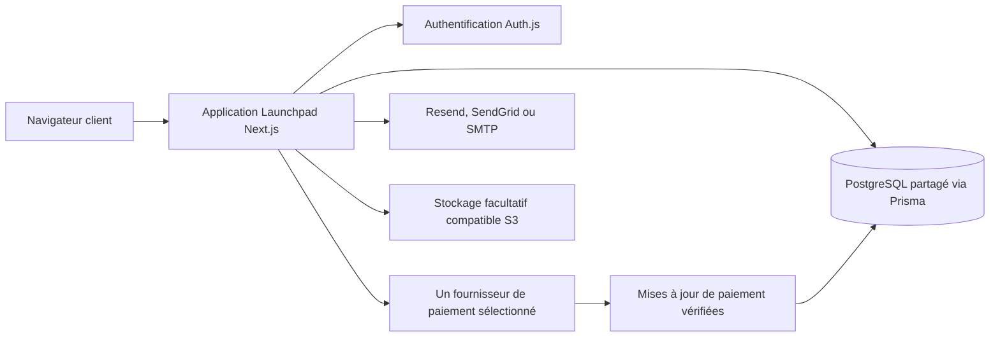

# Launchpad — une base complète pour produit SaaS

**Lancez un produit SaaS sans assembler ses systèmes essentiels à partir de zéro.**

Launchpad est une base complète pour produit SaaS : un codebase Next.js unifié
et un modèle de données PostgreSQL partagé pour les paiements,
l’authentification, l’analytique, l’administration, les espaces clients, le
contenu et des fonctionnalités produit optionnelles. Il s’adresse aux équipes
qui veulent garder le contrôle de leur application et de leur infrastructure,
plutôt que d’utiliser un service hébergé ou un ensemble de services déployés
séparément.

> Launchpad comprend des fonctions d’administration et de sécurité conçues
> pour la production, mais ne rend pas à lui seul un produit prêt pour la
> production. Vous restez responsable de la configuration des fournisseurs,
> du renforcement de la sécurité du déploiement, de la supervision
> opérationnelle et des vérifications juridiques et de sécurité propres à
> votre produit.

[Voir Launchpad sur Gumroad](https://shehroz2009.gumroad.com/l/launchpad-full-scale-saas-foundation)

Lisez ce README dans une autre langue :
[العربية](./README.ar.md) · [বাংলা](./README.bn.md) · [Deutsch](./README.de.md) ·
[Español](./README.es.md) · [हिन्दी](./README.hi.md) · [Bahasa Indonesia](./README.id.md) ·
[Italiano](./README.it.md) · [日本語](./README.ja.md) · [한국어](./README.ko.md) ·
[Nederlands](./README.nl.md) · [Polski](./README.pl.md) · [Português](./README.pt.md) ·
[Русский](./README.ru.md) · [Türkçe](./README.tr.md) · [Tiếng Việt](./README.vi.md) ·
[简体中文](./README.zh.md) · [English](../README.md)

## Aperçu du produit


| Espace client | Page des tarifs |
| ------------- | --------------- |
|  |  |

Consultez les [captures d’écran du produit en anglais](../screenshots/) ou
découvrez les pages d’accueil et de tarifs localisées dans [les 18 langues](../docs/FEATURES.md#localization).

## Ce que Launchpad comprend

- **Comptes clients :** connexion par e-mail localisée, OAuth Google/GitHub
  facultatif, routes protégées, authentification multifacteur TOTP et codes
  de récupération.
- **Facturation :** abonnements et achats uniques Lifetime via Stripe, Paddle,
  Lemon Squeezy ou PayPro Global, ainsi que la vérification facultative des
  achats Apple App Store / Google Play. Les événements de facturation peuvent
  aussi gérer les invitations facultatives aux dépôts privés GitHub et le
  retrait des accès.
- **Administration :** commandes protégées par rôle pour les utilisateurs,
  la sécurité, l’analytique, les intégrations, le contenu, le support et les
  modules activés.
- **Espace produit :** paramètres du compte, notifications, support,
  historique de facturation et fonctions facultatives d’organisation et de
  collaboration.
- **Fonctionnalités produit :** modules facultatifs pour les campagnes
  e-mail, l’IA, la publication, le marketing, le stockage, la communauté,
  les recommandations et plus encore.
- **Opérations :** configuration initiale, mises à jour du projet et
  déploiement guidé vers six cibles : Vercel + Neon, Docker / VM cloud,
  Fly.io, Google Cloud Run, AWS ECS Fargate et Kubernetes.

Les fonctionnalités liées à des fournisseurs nécessitent vos propres comptes,
identifiants et configurations. L’assistant de configuration teste les
identifiants sélectionnés, et les processus de déploiement peuvent
provisionner des ressources prises en charge dans les comptes connectés. Ils
ne créent pas de comptes fournisseurs et ne remplacent pas la préparation des
prérequis propres à la cible, l’octroi des autorisations, l’examen des coûts
ni la vérification des permissions de production.

Consultez la [matrice des fonctionnalités](../docs/FEATURES.md) et le
[guide détaillé d’implémentation et d’exploitation](../docs/FEATURE-GUIDE.md)
pour connaître le périmètre, les exigences et les limites actuels.

## Structure de l’application



L’application utilise des frontières modulaires au sein d’un seul codebase
déployable. Les modules sélectionnés réutilisent la même infrastructure
applicative et la même base de données ; leur sélection ne les transforme pas
en services ou bases de données indépendants.

## Technologies

| Domaine | Technologie |
| ------- | ----------- |
| Application | Next.js 16, React 19, TypeScript |
| Styles | Tailwind CSS 4, composants réutilisables compatibles avec shadcn/ui |
| Authentification | Auth.js, liens par e-mail, OAuth Google/GitHub facultatif |
| Données | PostgreSQL, Prisma |
| Paiements | Stripe, Paddle, Lemon Squeezy ou PayPro Global ; vérification facultative Apple App Store et Google Play |
| Qualité | ESLint, Prettier, vérifications TypeScript, tests automatisés |
| Déploiement | Contrôles GitHub Actions ; déploiement guidé vers six cibles prises en charge |

## Démarrer en local

Vous avez besoin de Git, npm, Node.js 20.19+ (ou 22.13+/24+) et de Docker
Desktop en cours d’exécution avec son daemon actif. L’assistant de premier
lancement utilise Docker pour la base de données locale et la boîte de
réception de test.

Clonez le dépôt et démarrez Launchpad depuis le répertoire du projet :

```bash
git clone https://github.com/Shehroz2009/Launchpad.git
cd Launchpad
npm run dev
```

Au premier démarrage, le navigateur ouvre l’assistant de configuration.
Choisissez les fonctionnalités et services souhaités ; l’assistant installe
leurs dépendances, démarre les conteneurs PostgreSQL et Mailpit inclus,
applique les migrations initiales, crée le compte administrateur et lance
l’application. Il n’est pas nécessaire d’exécuter séparément `npm install`,
de modifier `.env` ou de lancer une commande de migration.

Une fois l’application démarrée, utilisez **Admin → Integrations** et
**Admin → Deployment** pour configurer les fournisseurs et lancer un
déploiement. Ces processus nécessitent vos propres comptes et identifiants ;
les ressources créées dépendent de la cible et du plan de déploiement choisis.
Consultez le [guide de démarrage rapide](../docs/QUICKSTART.md) et le
[guide de déploiement](../docs/VERCEL.md) pour connaître les prérequis et les
limites.

## Documentation

- [Démarrage rapide et configuration](../docs/QUICKSTART.md)
- [Matrice des fonctionnalités et périmètre actuel](../docs/FEATURES.md)
- [Guide d’implémentation et d’exploitation](../docs/FEATURE-GUIDE.md)
- [Liste de contrôle du déploiement Vercel](../docs/VERCEL.md)
- [Captures d’écran du produit](../screenshots/)

## Licence et achat

Launchpad est un logiciel sous licence destiné au développement et à
l’exploitation d’un produit ou service. La licence n’autorise pas la
redistribution de Launchpad ou de son code source. Launchpad est régulièrement
mis à jour. Les options d’accès et les conditions d’achat actuelles figurent
sur la [page produit Gumroad](https://shehroz2009.gumroad.com/l/launchpad-full-scale-saas-foundation).
Launchpad est une application que vous hébergez et exploitez vous-même, et non
un service SaaS hébergé ; les frais d’hébergement et des fournisseurs tiers
sont distincts. Consultez les conditions de licence dans le fichier
[LICENSE](../LICENSE).
