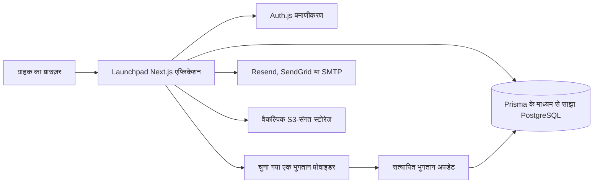

# Launchpad — SaaS उत्पादों की संपूर्ण आधारशिला

**मुख्य सिस्टम को शून्य से जोड़े बिना SaaS उत्पाद लॉन्च करें।**

Launchpad एक संपूर्ण SaaS उत्पाद आधारशिला है: भुगतान, प्रमाणीकरण, विश्लेषिकी,
प्रशासन, ग्राहक कार्यक्षेत्र, सामग्री और वैकल्पिक उत्पाद सुविधाओं के लिए एक
एकीकृत Next.js कोडबेस तथा साझा PostgreSQL डेटा मॉडल। यह उन टीमों के लिए बनाया
गया है जो होस्टेड सेवा या अलग-अलग तैनात सेवाओं के समूह पर निर्भर रहने के बजाय
अपने एप्लिकेशन और इंफ्रास्ट्रक्चर पर नियंत्रण चाहती हैं।

> Launchpad में प्रोडक्शन के लिए तैयार प्रशासन और सुरक्षा क्षमताएँ शामिल हैं,
> लेकिन यह अपने-आप किसी उत्पाद को प्रोडक्शन-तैयार नहीं बनाता। प्रोवाइडर
> कॉन्फ़िगरेशन, डिप्लॉयमेंट को सुरक्षित करना, परिचालन निगरानी और उत्पाद-विशिष्ट
> कानूनी तथा सुरक्षा समीक्षा आपकी जिम्मेदारी है।

[Gumroad पर Launchpad देखें](https://shehroz2009.gumroad.com/l/launchpad-full-scale-saas-foundation)

इस README को अन्य भाषाओं में पढ़ें:
[العربية](./README.ar.md) · [বাংলা](./README.bn.md) · [Deutsch](./README.de.md) ·
[Español](./README.es.md) · [Français](./README.fr.md) · [Bahasa Indonesia](./README.id.md) ·
[Italiano](./README.it.md) · [日本語](./README.ja.md) · [한국어](./README.ko.md) ·
[Nederlands](./README.nl.md) · [Polski](./README.pl.md) · [Português](./README.pt.md) ·
[Русский](./README.ru.md) · [Türkçe](./README.tr.md) · [Tiếng Việt](./README.vi.md) ·
[简体中文](./README.zh.md) · [English](../README.md)

## उत्पाद का पूर्वावलोकन


| ग्राहक कार्यक्षेत्र | मूल्य निर्धारण पृष्ठ |
| ------------------- | -------------------- |
|  |  |

[अंग्रेज़ी उत्पाद स्क्रीनशॉट](../screenshots/) देखें या
[सभी 18 भाषाओं](../docs/FEATURES.md#localization) के स्थानीयकृत लैंडिंग और
मूल्य निर्धारण पृष्ठ देखें।

## Launchpad में क्या शामिल है

- **ग्राहक खाते:** स्थानीयकृत ईमेल साइन-इन, वैकल्पिक Google/GitHub OAuth,
  सुरक्षित रूट, TOTP बहु-कारक प्रमाणीकरण और रिकवरी कोड।
- **बिलिंग:** Stripe, Paddle, Lemon Squeezy या PayPro Global के माध्यम से
  सदस्यताएँ और एकमुश्त Lifetime खरीद; साथ ही वैकल्पिक Apple App Store /
  Google Play खरीद सत्यापन। बिलिंग इवेंट वैकल्पिक निजी GitHub रिपॉज़िटरी
  आमंत्रण और एक्सेस हटाने को भी चला सकते हैं।
- **प्रशासन:** उपयोगकर्ताओं, सुरक्षा, विश्लेषिकी, इंटीग्रेशन, सामग्री,
  सहायता और सक्षम मॉड्यूल के लिए भूमिका-सुरक्षित नियंत्रण।
- **उत्पाद कार्यक्षेत्र:** खाता सेटिंग, सूचनाएँ, सहायता, बिलिंग इतिहास और
  वैकल्पिक संगठन तथा सहयोग सुविधाएँ।
- **उत्पाद क्षमताएँ:** ईमेल अभियान, AI, प्रकाशन, मार्केटिंग, स्टोरेज,
  समुदाय, रेफ़रल और अन्य के लिए वैकल्पिक मॉड्यूल।
- **संचालन:** पहली बार का सेटअप, प्रोजेक्ट अपडेट और छह लक्ष्यों पर निर्देशित
  डिप्लॉयमेंट: Vercel + Neon, Docker / Cloud VM, Fly.io, Google Cloud Run,
  AWS ECS Fargate और Kubernetes।

प्रोवाइडर-आधारित क्षमताओं के लिए आपके अपने प्रोवाइडर खाते, क्रेडेंशियल और
कॉन्फ़िगरेशन आवश्यक हैं। सेटअप विज़ार्ड चुने गए क्रेडेंशियल की जाँच करता है;
डिप्लॉयमेंट वर्कफ़्लो जुड़े हुए खातों में समर्थित संसाधन बना सकते हैं। वे
प्रोवाइडर खाते नहीं बनाते और लक्ष्य-विशिष्ट पूर्वापेक्षाएँ तैयार करने,
अनुमतियाँ देने, लागत की समीक्षा करने तथा प्रोडक्शन अनुमतियों की पुष्टि करने
की आवश्यकता को समाप्त नहीं करते।

वर्तमान दायरे, आवश्यकताओं और सीमाओं के लिए [फ़ीचर मैट्रिक्स](../docs/FEATURES.md)
और विस्तृत [इम्प्लीमेंटेशन तथा ऑपरेशंस गाइड](../docs/FEATURE-GUIDE.md) देखें।

## एप्लिकेशन की संरचना



एप्लिकेशन एक ही डिप्लॉय किए जा सकने वाले कोडबेस के भीतर मॉड्यूलर सीमाओं का
उपयोग करता है। चुने गए मॉड्यूल उसी एप्लिकेशन और डेटाबेस इंफ्रास्ट्रक्चर का
पुनः उपयोग करते हैं; मॉड्यूल चुनने से वे स्वतंत्र सेवाएँ या डेटाबेस नहीं बनते।

## तकनीक

| क्षेत्र | तकनीक |
| ------ | ------ |
| एप्लिकेशन | Next.js 16, React 19, TypeScript |
| स्टाइलिंग | Tailwind CSS 4, shadcn/ui-संगत पुनः उपयोग योग्य कंपोनेंट |
| प्रमाणीकरण | Auth.js, ईमेल लिंक, वैकल्पिक Google/GitHub OAuth |
| डेटा | PostgreSQL, Prisma |
| भुगतान | Stripe, Paddle, Lemon Squeezy या PayPro Global; वैकल्पिक Apple App Store और Google Play सत्यापन |
| गुणवत्ता | ESLint, Prettier, TypeScript जाँच, स्वचालित परीक्षण |
| डिप्लॉयमेंट | GitHub Actions जाँच; छह समर्थित लक्ष्यों पर निर्देशित डिप्लॉयमेंट |

## स्थानीय रूप से शुरू करें

आपको Git, npm, Node.js 20.19+ (या 22.13+/24+) और चालू daemon वाला Docker
Desktop चाहिए। पहली बार का विज़ार्ड स्थानीय डेटाबेस और ईमेल इनबॉक्स के लिए
Docker का उपयोग करता है।

रिपॉज़िटरी क्लोन करें और प्रोजेक्ट डायरेक्टरी से Launchpad शुरू करें:

```bash
git clone https://github.com/Shehroz2009/Launchpad.git
cd Launchpad
npm run dev
```

पहली बार शुरू करने पर ब्राउज़र में सेटअप विज़ार्ड खुलेगा। इच्छित सुविधाएँ और
सेवाएँ चुनें; विज़ार्ड उनकी निर्भरताएँ इंस्टॉल करता है, शामिल PostgreSQL और
Mailpit कंटेनर शुरू करता है, शुरुआती माइग्रेशन लागू करता है, एडमिन खाता
बनाता है और एप्लिकेशन लॉन्च करता है। अलग से `npm install` चलाने, `.env`
संपादित करने या माइग्रेशन कमांड चलाने की आवश्यकता नहीं है।

एप्लिकेशन चलने के बाद प्रोवाइडर कॉन्फ़िगर करने और डिप्लॉयमेंट शुरू करने के
लिए **Admin → Integrations** और **Admin → Deployment** खोलें। इन वर्कफ़्लो
के लिए आपके अपने प्रोवाइडर खाते और क्रेडेंशियल आवश्यक हैं; बनाए गए संसाधन
चुने गए लक्ष्य और डिप्लॉयमेंट योजना पर निर्भर करते हैं। पूर्वापेक्षाओं और
सीमाओं के लिए [क्विकस्टार्ट](../docs/QUICKSTART.md) और
[डिप्लॉयमेंट गाइड](../docs/VERCEL.md) देखें।

## दस्तावेज़

- [क्विकस्टार्ट और कॉन्फ़िगरेशन](../docs/QUICKSTART.md)
- [फ़ीचर मैट्रिक्स और वर्तमान दायरा](../docs/FEATURES.md)
- [इम्प्लीमेंटेशन और ऑपरेशंस गाइड](../docs/FEATURE-GUIDE.md)
- [Vercel डिप्लॉयमेंट चेकलिस्ट](../docs/VERCEL.md)
- [उत्पाद स्क्रीनशॉट](../screenshots/)

## लाइसेंस और खरीद

Launchpad एक उत्पाद या सेवा विकसित करने और चलाने के लिए लाइसेंस प्राप्त
सॉफ़्टवेयर है। लाइसेंस Launchpad या उसके सोर्स कोड को पुनर्वितरित करने की
अनुमति नहीं देता। Launchpad नियमित रूप से अपडेट होता है। वर्तमान एक्सेस
विकल्प और खरीद की शर्तें
[Gumroad उत्पाद पृष्ठ](https://shehroz2009.gumroad.com/l/launchpad-full-scale-saas-foundation)
पर उपलब्ध हैं। Launchpad ऐसा एप्लिकेशन सॉफ़्टवेयर है जिसे आप स्वयं होस्ट और
चलाते हैं, होस्टेड SaaS सेवा नहीं; होस्टिंग और तृतीय-पक्ष प्रोवाइडर शुल्क
अलग हैं। लाइसेंस की शर्तों के लिए संलग्न [LICENSE](../LICENSE) देखें।
