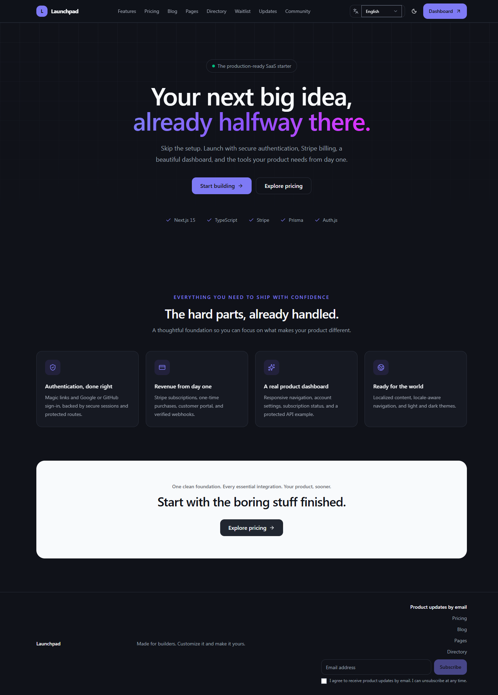
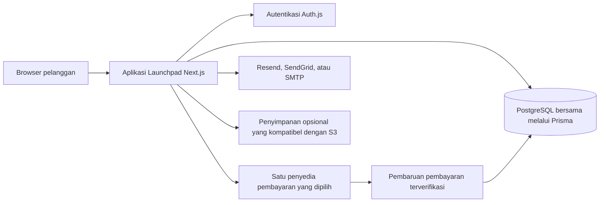

# Launchpad — Fondasi SaaS yang Lengkap

**Luncurkan produk SaaS tanpa merangkai sistem intinya dari nol.**

Launchpad adalah fondasi produk SaaS yang lengkap: satu basis kode Next.js
terpadu dan model data PostgreSQL bersama untuk pembayaran, autentikasi,
analitik, administrasi, ruang kerja pelanggan, konten, dan kemampuan produk
opsional. Launchpad dibuat bagi tim yang ingin mengendalikan aplikasi dan
infrastrukturnya sendiri, bukan mengandalkan layanan terhosting atau kumpulan
layanan yang diterapkan secara terpisah.

> Launchpad menyertakan kemampuan administrasi dan keamanan yang berorientasi
> pada produksi, tetapi tidak otomatis menjadikan produk siap produksi. Anda
> tetap bertanggung jawab atas konfigurasi penyedia, penguatan keamanan
> deployment, pemantauan operasional, serta tinjauan hukum dan keamanan yang
> khusus untuk produk Anda.

[Lihat Launchpad di Gumroad](https://shehroz2009.gumroad.com/l/launchpad-full-scale-saas-foundation)

Baca README ini dalam bahasa lain:
[العربية](./README.ar.md) · [বাংলা](./README.bn.md) · [Deutsch](./README.de.md) ·
[Español](./README.es.md) · [Français](./README.fr.md) · [हिन्दी](./README.hi.md) ·
[Italiano](./README.it.md) · [日本語](./README.ja.md) · [한국어](./README.ko.md) ·
[Nederlands](./README.nl.md) · [Polski](./README.pl.md) · [Português](./README.pt.md) ·
[Русский](./README.ru.md) · [Türkçe](./README.tr.md) · [Tiếng Việt](./README.vi.md) ·
[简体中文](./README.zh.md) · [English](../README.md)

## Pratinjau produk



| Ruang kerja pelanggan | Halaman harga |
| --------------------- | ------------- |
|  |  |

Jelajahi [tangkapan layar produk berbahasa Inggris](../screenshots/) atau
halaman landing dan harga yang dilokalkan untuk [semua 18 bahasa](../docs/FEATURES.md#localization).

## Fitur Launchpad

- **Akun pelanggan:** masuk dengan email yang dilokalkan, OAuth Google/GitHub
  opsional, rute terlindungi, autentikasi multifaktor TOTP, dan kode pemulihan.
- **Penagihan:** langganan dan pembelian Lifetime satu kali melalui Stripe,
  Paddle, Lemon Squeezy, atau PayPro Global, serta verifikasi pembelian Apple
  App Store / Google Play opsional. Peristiwa penagihan juga dapat mengelola
  undangan opsional ke repositori privat GitHub dan pencabutan akses.
- **Administrasi:** kontrol berbasis peran untuk pengguna, keamanan, analitik,
  integrasi, konten, dukungan, dan modul yang diaktifkan.
- **Ruang kerja produk:** pengaturan akun, notifikasi, dukungan, riwayat
  penagihan, serta fitur organisasi dan kolaborasi opsional.
- **Kemampuan produk:** modul opsional untuk kampanye email, AI, publikasi,
  pemasaran, penyimpanan, komunitas, referral, dan lainnya.
- **Operasional:** penyiapan awal, pembaruan proyek, dan deployment terpandu
  ke enam target: Vercel + Neon, Docker / VM cloud, Fly.io, Google Cloud Run,
  AWS ECS Fargate, dan Kubernetes.

Fitur yang bergantung pada penyedia memerlukan akun penyedia, kredensial, dan
konfigurasi milik Anda sendiri. Wizard penyiapan menguji kredensial yang
dipilih, sementara alur deployment dapat menyediakan sumber daya yang didukung
di akun yang terhubung. Alur ini tidak membuat akun penyedia dan tidak
menggantikan persiapan prasyarat target, pemberian persetujuan, peninjauan
biaya, atau verifikasi izin produksi.

Lihat [matriks fitur](../docs/FEATURES.md) dan
[panduan implementasi dan operasional](../docs/FEATURE-GUIDE.md) untuk cakupan,
persyaratan, dan batasan terkini.

## Struktur aplikasi



Aplikasi menggunakan batas modular dalam satu basis kode yang dapat
di-deploy. Modul yang dipilih menggunakan infrastruktur aplikasi dan basis
data yang sama; pemilihan modul tidak mengubahnya menjadi layanan atau basis
data yang terpisah.

## Teknologi

| Area | Teknologi |
| ---- | --------- |
| Aplikasi | Next.js 16, React 19, TypeScript |
| Gaya | Tailwind CSS 4, komponen yang dapat digunakan kembali dan kompatibel dengan shadcn/ui |
| Autentikasi | Auth.js, tautan email, OAuth Google/GitHub opsional |
| Data | PostgreSQL, Prisma |
| Pembayaran | Stripe, Paddle, Lemon Squeezy, atau PayPro Global; verifikasi Apple App Store dan Google Play opsional |
| Kualitas | ESLint, Prettier, pemeriksaan TypeScript, tes otomatis |
| Deployment | Pemeriksaan GitHub Actions; deployment terpandu ke enam target yang didukung |

## Mulai secara lokal

Anda memerlukan Git, npm, Node.js 20.19+ (atau 22.13+/24+), serta Docker
Desktop yang berjalan dengan daemon aktif. Wizard pertama kali menggunakan
Docker untuk basis data lokal dan kotak masuk email.

Klon repositori dan jalankan Launchpad dari direktori proyek:

```bash
git clone https://github.com/Shehroz2009/Launchpad.git
cd Launchpad
npm run dev
```

Saat pertama kali dijalankan, browser akan membuka wizard penyiapan. Pilih
fitur dan layanan yang Anda inginkan; wizard menginstal dependensi terpilih,
menjalankan kontainer PostgreSQL dan Mailpit yang disertakan, menerapkan
migrasi awal, membuat akun administrator, lalu menjalankan aplikasi. Anda
tidak perlu menjalankan `npm install` secara terpisah, mengedit `.env`, atau
menjalankan perintah migrasi.

Setelah aplikasi berjalan, buka **Admin → Integrations** dan
**Admin → Deployment** untuk mengonfigurasi penyedia dan memulai deployment.
Alur ini memerlukan akun penyedia dan kredensial milik Anda; sumber daya yang
dibuat bergantung pada target dan rencana deployment yang dipilih. Lihat
[panduan cepat](../docs/QUICKSTART.md) dan
[panduan deployment](../docs/VERCEL.md) untuk prasyarat dan batasan.

## Dokumentasi

- [Panduan cepat dan konfigurasi](../docs/QUICKSTART.md)
- [Matriks fitur dan cakupan terkini](../docs/FEATURES.md)
- [Panduan implementasi dan operasional](../docs/FEATURE-GUIDE.md)
- [Daftar periksa deployment Vercel](../docs/VERCEL.md)
- [Tangkapan layar produk](../screenshots/)

## Lisensi dan pembelian

Launchpad adalah perangkat lunak berlisensi untuk mengembangkan dan
mengoperasikan satu produk atau layanan. Lisensi tidak mengizinkan
redistribusi Launchpad atau kode sumbernya. Launchpad diperbarui secara
berkala. Opsi akses dan ketentuan pembelian terkini tersedia di
[halaman produk Gumroad](https://shehroz2009.gumroad.com/l/launchpad-full-scale-saas-foundation).
Launchpad adalah perangkat lunak aplikasi yang Anda host dan operasikan
sendiri, bukan layanan SaaS terhosting; biaya hosting dan penyedia pihak
ketiga dikenakan terpisah. Lihat ketentuan lisensi pada file
[LICENSE](../LICENSE).
