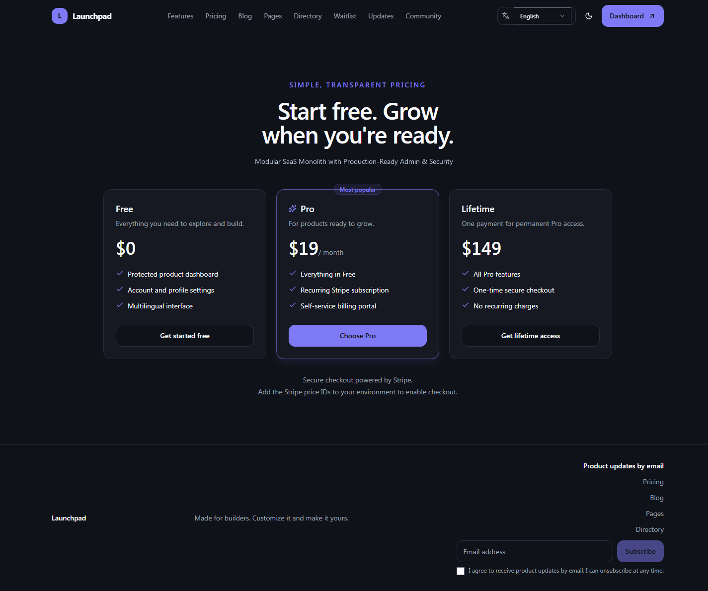
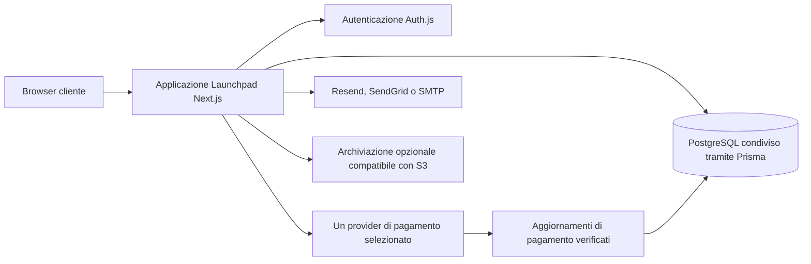

# Launchpad — una base completa per prodotti SaaS

**Lancia un prodotto SaaS senza assemblarne da zero i sistemi fondamentali.**

Launchpad è una base completa per prodotti SaaS: un'unica codebase Next.js
coesa e un modello dati PostgreSQL condiviso per pagamenti, autenticazione,
analisi, amministrazione, spazi di lavoro dei clienti, contenuti e funzionalità
opzionali. È pensato per i team che vogliono controllare la propria
applicazione e infrastruttura, senza affidarsi a un servizio ospitato o a una
raccolta di servizi distribuiti separatamente.

> Launchpad include funzionalità amministrative e di sicurezza pensate per la
> produzione, ma da solo non rende un prodotto pronto per la produzione.
> Restano a tuo carico la configurazione dei provider, il rafforzamento della
> sicurezza del deployment, il monitoraggio operativo e le verifiche legali e
> di sicurezza specifiche del prodotto.

[Scopri Launchpad su Gumroad](https://shehroz2009.gumroad.com/l/launchpad-full-scale-saas-foundation)

Leggi questo README in un'altra lingua:
[العربية](./README.ar.md) · [বাংলা](./README.bn.md) · [Deutsch](./README.de.md) ·
[Español](./README.es.md) · [Français](./README.fr.md) · [हिन्दी](./README.hi.md) ·
[Bahasa Indonesia](./README.id.md) · [日本語](./README.ja.md) ·
[한국어](./README.ko.md) · [Nederlands](./README.nl.md) · [Polski](./README.pl.md) ·
[Português](./README.pt.md) · [Русский](./README.ru.md) · [Türkçe](./README.tr.md) ·
[Tiếng Việt](./README.vi.md) · [简体中文](./README.zh.md) · [English](../README.md)

## Anteprima del prodotto


| Spazio di lavoro cliente | Pagina dei prezzi |
| ------------------------ | ----------------- |
|  |  |

Esplora gli [screenshot del prodotto in inglese](../screenshots/) o le pagine
localizzate di presentazione e prezzi per [tutte le 18 lingue](../docs/FEATURES.md#localization).

## Cosa include Launchpad

- **Account cliente:** accesso e-mail localizzato, OAuth Google/GitHub
  facoltativo, percorsi protetti, autenticazione multifattore TOTP e codici
  di recupero.
- **Fatturazione:** abbonamenti e acquisti Lifetime una tantum tramite Stripe,
  Paddle, Lemon Squeezy o PayPro Global, oltre alla verifica facoltativa degli
  acquisti su Apple App Store / Google Play. Gli eventi di fatturazione possono
  anche gestire inviti facoltativi a repository privati GitHub e la revoca
  dell'accesso.
- **Amministrazione:** controlli protetti in base al ruolo per utenti,
  sicurezza, analisi, integrazioni, contenuti, supporto e moduli attivati.
- **Spazio di lavoro prodotto:** impostazioni dell'account, notifiche,
  supporto, cronologia di fatturazione e funzionalità facoltative per
  organizzazioni e collaborazione.
- **Funzionalità prodotto:** moduli facoltativi per campagne e-mail, AI,
  pubblicazione, marketing, archiviazione, community, referral e altro.
- **Operazioni:** configurazione iniziale, aggiornamenti del progetto e
  deployment guidato verso sei destinazioni: Vercel + Neon, Docker / VM cloud,
  Fly.io, Google Cloud Run, AWS ECS Fargate e Kubernetes.

Le funzionalità basate su provider richiedono account, credenziali e
configurazioni di tua proprietà. La procedura guidata verifica le credenziali
selezionate; i flussi di deployment possono predisporre risorse supportate
negli account collegati. Non creano account provider e non sostituiscono la
preparazione dei prerequisiti della destinazione, la concessione dei consensi,
la revisione dei costi o la verifica delle autorizzazioni di produzione.

Consulta la [matrice delle funzionalità](../docs/FEATURES.md) e la
[guida dettagliata all'implementazione e alle operazioni](../docs/FEATURE-GUIDE.md)
per conoscere ambito, requisiti e limitazioni attuali.

## Struttura dell'applicazione



L'applicazione usa confini modulari all'interno di un'unica codebase
distribuibile. I moduli selezionati riutilizzano la stessa infrastruttura
applicativa e di database; la selezione dei moduli non li trasforma in servizi
o database indipendenti.

## Tecnologia

| Area | Tecnologia |
| ---- | ---------- |
| Applicazione | Next.js 16, React 19, TypeScript |
| Stili | Tailwind CSS 4, componenti riutilizzabili compatibili con shadcn/ui |
| Autenticazione | Auth.js, link e-mail, OAuth Google/GitHub facoltativo |
| Dati | PostgreSQL, Prisma |
| Pagamenti | Stripe, Paddle, Lemon Squeezy o PayPro Global; verifica facoltativa Apple App Store e Google Play |
| Qualità | ESLint, Prettier, controlli TypeScript, test automatizzati |
| Deployment | Controlli GitHub Actions; deployment guidato verso sei destinazioni supportate |

## Avvio locale

Servono Git, npm, Node.js 20.19+ (oppure 22.13+/24+) e Docker Desktop
in esecuzione con il daemon attivo. La procedura guidata iniziale usa Docker
per il database locale e la casella e-mail di test.

Clona il repository e avvia Launchpad dalla directory del progetto:

```bash
git clone https://github.com/Shehroz2009/Launchpad.git
cd Launchpad
npm run dev
```

Al primo avvio, il browser apre la procedura guidata di configurazione. Scegli
le funzionalità e i servizi desiderati: la procedura installa le dipendenze
selezionate, avvia i container PostgreSQL e Mailpit inclusi, applica le
migrazioni iniziali, crea l'account amministratore e avvia l'applicazione. Non
servono un comando separato `npm install`, modifiche a `.env` o un comando di
migrazione.

Quando l'applicazione è in esecuzione, usa **Admin → Integrations** e
**Admin → Deployment** per configurare i provider e avviare un deployment.
Questi flussi richiedono account e credenziali di tua proprietà; le risorse
create dipendono dalla destinazione e dal piano selezionati. Consulta la
[guida rapida](../docs/QUICKSTART.md) e la
[guida al deployment](../docs/VERCEL.md) per prerequisiti e limitazioni.

## Documentazione

- [Guida rapida e configurazione](../docs/QUICKSTART.md)
- [Matrice delle funzionalità e ambito attuale](../docs/FEATURES.md)
- [Guida all'implementazione e alle operazioni](../docs/FEATURE-GUIDE.md)
- [Checklist per il deployment su Vercel](../docs/VERCEL.md)
- [Screenshot del prodotto](../screenshots/)

## Licenza e acquisto

Launchpad è un software concesso in licenza per sviluppare e gestire un
prodotto o servizio. La licenza non consente di ridistribuire Launchpad o il
suo codice sorgente. Launchpad viene aggiornato regolarmente. Le opzioni di
accesso e le condizioni di acquisto attuali sono riportate nella
[pagina del prodotto su Gumroad](https://shehroz2009.gumroad.com/l/launchpad-full-scale-saas-foundation).
Launchpad è un'applicazione che ospiti e gestisci autonomamente, non un
servizio SaaS ospitato; i costi di hosting e dei provider di terze parti sono
separati. Consulta i termini della licenza nel file [LICENSE](../LICENSE).
