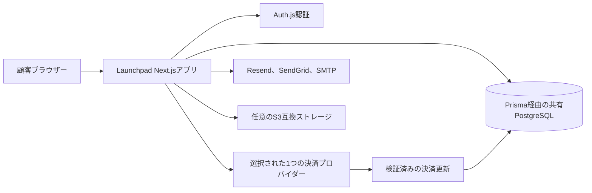

# Launchpad — SaaS製品のための包括的な基盤

**コアシステムをゼロから組み立てずに、SaaS製品を立ち上げましょう。**

Launchpadは、決済、認証、分析、管理、顧客ワークスペース、コンテンツ、
オプションの製品機能を支える、統合されたNext.jsコードベースと共有
PostgreSQLデータモデルを備えた包括的なSaaS製品基盤です。ホスト型
サービスや個別にデプロイされたサービス群に依存せず、アプリケーション
とインフラを自分たちで管理したいチーム向けに作られています。

> Launchpadには本番運用を見据えた管理機能とセキュリティ機能が含まれ
> ますが、それだけで製品が本番環境に対応できるわけではありません。
> プロバイダーの設定、デプロイのセキュリティ強化、運用監視、製品固有
> の法務・セキュリティ確認は引き続き利用者の責任です。

[GumroadでLaunchpadを見る](https://shehroz2009.gumroad.com/l/launchpad-full-scale-saas-foundation)

このREADMEは他の言語でも読めます：
[العربية](./README.ar.md) · [বাংলা](./README.bn.md) · [Deutsch](./README.de.md) ·
[Español](./README.es.md) · [Français](./README.fr.md) · [हिन्दी](./README.hi.md) ·
[Bahasa Indonesia](./README.id.md) · [Italiano](./README.it.md) ·
[한국어](./README.ko.md) · [Nederlands](./README.nl.md) · [Polski](./README.pl.md) ·
[Português](./README.pt.md) · [Русский](./README.ru.md) · [Türkçe](./README.tr.md) ·
[Tiếng Việt](./README.vi.md) · [简体中文](./README.zh.md) · [English](../README.md)

## 製品プレビュー


| 顧客ワークスペース | 料金ページ |
| ------------------ | ---------- |
|  |  |

[英語版の製品スクリーンショット](../screenshots/)や、
[18言語すべて](../docs/FEATURES.md#localization)にローカライズされた
ランディングページと料金ページをご覧ください。

## Launchpadに含まれるもの

- **顧客アカウント：**ローカライズされたメールログイン、任意の
  Google/GitHub OAuth、保護されたルート、TOTP多要素認証、リカバリーコード。
- **請求：**Stripe、Paddle、Lemon Squeezy、PayPro Globalによる
  サブスクリプションと一回限りのLifetime購入に加え、Apple App Store /
  Google Play購入の任意の検証。請求イベントから、GitHubのプライベート
  リポジトリへの招待やアクセスの取り消しを行うこともできます。
- **管理機能：**ユーザー、セキュリティ、分析、連携、コンテンツ、
  サポート、有効化されたモジュールをロールベースで管理できます。
- **製品ワークスペース：**アカウント設定、通知、サポート、請求履歴、
  任意の組織・コラボレーション機能。
- **製品機能：**メールキャンペーン、AI、公開、マーケティング、
  ストレージ、コミュニティ、紹介プログラムなどの任意モジュール。
- **運用：**初回セットアップ、プロジェクト更新、6つの対象への
  ガイド付きデプロイ（Vercel + Neon、Docker / Cloud VM、Fly.io、
  Google Cloud Run、AWS ECS Fargate、Kubernetes）。

プロバイダーに依存する機能には、利用者自身のプロバイダーアカウント、
認証情報、設定が必要です。セットアップウィザードは選択された認証情報
を検証し、デプロイワークフローは接続済みアカウントに対応リソースを
作成できます。プロバイダーアカウント自体は作成しません。対象固有の
前提条件を準備し、同意を与え、費用を確認し、本番権限を検証する必要が
あります。

現在の範囲、要件、制限については、[機能一覧](../docs/FEATURES.md)と
詳細な[実装・運用ガイド](../docs/FEATURE-GUIDE.md)をご覧ください。

## アプリケーションの構成



アプリケーションは、単一のデプロイ可能なコードベース内でモジュールの
境界を設けています。選択したモジュールは同じアプリケーションとデータ
ベースのインフラを共有します。モジュールを選んでも、独立したサービス
やデータベースになるわけではありません。

## 技術

| 分野 | 技術 |
| ---- | ---- |
| アプリケーション | Next.js 16、React 19、TypeScript |
| スタイル | Tailwind CSS 4、shadcn/ui互換の再利用可能なコンポーネント |
| 認証 | Auth.js、メールリンク、任意のGoogle/GitHub OAuth |
| データ | PostgreSQL、Prisma |
| 決済 | Stripe、Paddle、Lemon Squeezy、PayPro Global；Apple App StoreとGoogle Playの任意検証 |
| 品質 | ESLint、Prettier、TypeScriptチェック、自動テスト |
| デプロイ | GitHub Actionsによるチェック；6つの対応対象へのガイド付きデプロイ |

## ローカルで始める

Git、npm、Node.js 20.19+（または22.13+/24+）と、デーモンが起動した
Docker Desktopが必要です。初回起動ウィザードは、ローカルデータベースと
メール受信箱にDockerを使用します。

リポジトリをクローンし、プロジェクトディレクトリからLaunchpadを起動します：

```bash
git clone https://github.com/Shehroz2009/Launchpad.git
cd Launchpad
npm run dev
```

初回起動時にブラウザーでセットアップウィザードが開きます。必要な機能
とサービスを選ぶと、ウィザードが依存関係をインストールし、同梱の
PostgreSQLとMailpitのコンテナーを起動し、初期マイグレーションを適用し、
管理者アカウントを作成してアプリケーションを起動します。別途
`npm install`を実行したり、`.env`を編集したり、マイグレーション
コマンドを実行したりする必要はありません。

アプリケーションの起動後、**Admin → Integrations**と
**Admin → Deployment**からプロバイダーを設定し、デプロイを開始します。
このワークフローには利用者自身のプロバイダーアカウントと認証情報が
必要です。作成されるリソースは選択した対象とデプロイ計画によって
異なります。前提条件と制限については[クイックスタート](../docs/QUICKSTART.md)
と[デプロイガイド](../docs/VERCEL.md)をご覧ください。

## ドキュメント

- [クイックスタートと設定](../docs/QUICKSTART.md)
- [機能一覧と現在の範囲](../docs/FEATURES.md)
- [実装・運用ガイド](../docs/FEATURE-GUIDE.md)
- [Vercelデプロイチェックリスト](../docs/VERCEL.md)
- [製品スクリーンショット](../screenshots/)

## ライセンスと購入

Launchpadは、1つの製品またはサービスを開発・運用するためのライセンス
ソフトウェアです。ライセンスはLaunchpadやそのソースコードの再配布を
許可していません。Launchpadは定期的に更新されます。現在のアクセス
方法と購入条件は[Gumroad製品ページ](https://shehroz2009.gumroad.com/l/launchpad-full-scale-saas-foundation)
をご覧ください。Launchpadは利用者自身がホストし運用するアプリケーション
ソフトウェアであり、ホスト型SaaSサービスではありません。ホスティング
料金とサードパーティープロバイダーの料金は別途かかります。ライセンス
条件は同梱の[LICENSE](../LICENSE)をご確認ください。
