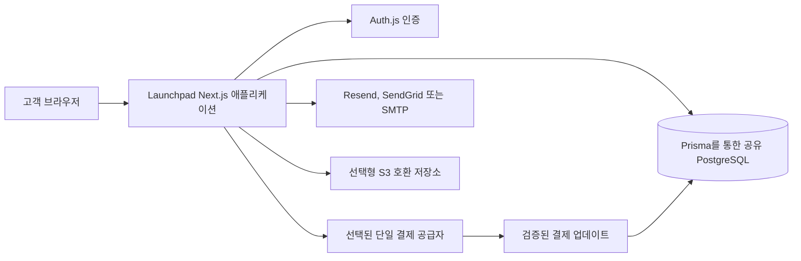

# Launchpad — 완성형 SaaS 제품 기반

**핵심 시스템을 처음부터 조립하지 않고 SaaS 제품을 출시하세요.**

Launchpad는 결제, 인증, 분석, 관리, 고객 작업 공간, 콘텐츠 및 선택형
제품 기능을 위한 통합 Next.js 코드베이스와 공유 PostgreSQL 데이터 모델을
제공하는 완성형 SaaS 제품 기반입니다. 호스팅 서비스나 별도로 배포되는
서비스 모음에 의존하지 않고 애플리케이션과 인프라를 직접 관리하려는
팀을 위해 만들어졌습니다.

> Launchpad에는 프로덕션 환경을 고려한 관리 및 보안 기능이 포함되어
> 있지만, 이것만으로 제품이 프로덕션 준비를 마치는 것은 아닙니다.
> 공급자 설정, 배포 보안 강화, 운영 모니터링, 제품별 법률 및 보안 검토는
> 계속 사용자의 책임입니다.

[Gumroad에서 Launchpad 보기](https://shehroz2009.gumroad.com/l/launchpad-full-scale-saas-foundation)

다른 언어로 이 README 읽기:
[العربية](./README.ar.md) · [বাংলা](./README.bn.md) · [Deutsch](./README.de.md) ·
[Español](./README.es.md) · [Français](./README.fr.md) · [हिन्दी](./README.hi.md) ·
[Bahasa Indonesia](./README.id.md) · [Italiano](./README.it.md) ·
[日本語](./README.ja.md) · [Nederlands](./README.nl.md) · [Polski](./README.pl.md) ·
[Português](./README.pt.md) · [Русский](./README.ru.md) · [Türkçe](./README.tr.md) ·
[Tiếng Việt](./README.vi.md) · [简体中文](./README.zh.md) · [English](../README.md)

## 제품 미리보기


| 고객 작업 공간 | 요금 페이지 |
| -------------- | ----------- |
|  |  |

[영문 제품 스크린샷](../screenshots/)을 살펴보거나 [18개 언어 전체](../docs/FEATURES.md#localization)
로 현지화된 랜딩 및 요금 페이지를 확인하세요.

## Launchpad에 포함된 기능

- **고객 계정:** 현지화된 이메일 로그인, 선택형 Google/GitHub OAuth,
  보호된 경로, TOTP 다단계 인증 및 복구 코드.
- **결제:** Stripe, Paddle, Lemon Squeezy 또는 PayPro Global을 통한
  구독 및 일회성 Lifetime 구매와 선택형 Apple App Store / Google Play
  구매 검증. 결제 이벤트로 선택형 GitHub 비공개 저장소 초대와 접근
  권한 제거를 처리할 수도 있습니다.
- **관리:** 사용자, 보안, 분석, 통합, 콘텐츠, 지원 및 활성화된 모듈을
  역할 기반으로 관리합니다.
- **제품 작업 공간:** 계정 설정, 알림, 지원, 결제 내역 및 선택형 조직과
  협업 기능.
- **제품 기능:** 이메일 캠페인, AI, 게시, 마케팅, 저장소, 커뮤니티,
  추천 프로그램 등을 위한 선택형 모듈.
- **운영:** 초기 설정, 프로젝트 업데이트 및 여섯 가지 대상에 대한
  안내형 배포: Vercel + Neon, Docker / Cloud VM, Fly.io, Google Cloud Run,
  AWS ECS Fargate, Kubernetes.

공급자 기반 기능에는 사용자 소유의 공급자 계정, 자격 증명 및 설정이
필요합니다. 설정 마법사는 선택한 자격 증명을 테스트하고, 배포 워크플로는
연결된 계정에 지원되는 리소스를 프로비저닝할 수 있습니다. 이 워크플로는
공급자 계정을 만들지 않으며 대상별 사전 요구 사항 준비, 동의 부여,
비용 검토 및 프로덕션 권한 확인을 대신하지 않습니다.

현재 범위, 요구 사항 및 제한 사항은 [기능 매트릭스](../docs/FEATURES.md)와
자세한 [구현 및 운영 가이드](../docs/FEATURE-GUIDE.md)를 참조하세요.

## 애플리케이션 구조



애플리케이션은 하나의 배포 가능한 코드베이스 안에서 모듈 경계를
사용합니다. 선택한 모듈은 동일한 애플리케이션 및 데이터베이스 인프라를
재사용하며, 모듈 선택이 독립된 서비스나 데이터베이스를 만들지는 않습니다.

## 기술

| 영역 | 기술 |
| ---- | ---- |
| 애플리케이션 | Next.js 16, React 19, TypeScript |
| 스타일 | Tailwind CSS 4, shadcn/ui 호환 재사용 컴포넌트 |
| 인증 | Auth.js, 이메일 링크, 선택형 Google/GitHub OAuth |
| 데이터 | PostgreSQL, Prisma |
| 결제 | Stripe, Paddle, Lemon Squeezy 또는 PayPro Global; 선택형 Apple App Store 및 Google Play 검증 |
| 품질 | ESLint, Prettier, TypeScript 검사, 자동화 테스트 |
| 배포 | GitHub Actions 검사; 지원되는 여섯 가지 대상에 대한 안내형 배포 |

## 로컬에서 시작하기

Git, npm, Node.js 20.19+ (또는 22.13+/24+)와 데몬이 실행 중인 Docker
Desktop이 필요합니다. 최초 실행 마법사는 로컬 데이터베이스와 이메일
받은 편지함에 Docker를 사용합니다.

저장소를 복제하고 프로젝트 디렉터리에서 Launchpad를 시작하세요.

```bash
git clone https://github.com/Shehroz2009/Launchpad.git
cd Launchpad
npm run dev
```

처음 실행하면 브라우저에서 설정 마법사가 열립니다. 원하는 기능과
서비스를 선택하면 마법사가 해당 의존성을 설치하고 포함된 PostgreSQL 및
Mailpit 컨테이너를 시작하며, 초기 마이그레이션을 적용하고 관리자 계정을
만든 뒤 애플리케이션을 실행합니다. 별도의 `npm install`, `.env` 편집
또는 마이그레이션 명령은 필요하지 않습니다.

애플리케이션이 실행되면 공급자를 구성하고 배포를 시작할 수 있도록
**Admin → Integrations** 및 **Admin → Deployment**를 여세요. 이 워크플로에는
사용자 소유의 공급자 계정과 자격 증명이 필요하며, 생성되는 리소스는 선택한
대상과 배포 계획에 따라 달라집니다. 사전 요구 사항과 제한 사항은
[빠른 시작 가이드](../docs/QUICKSTART.md) 및
[배포 가이드](../docs/VERCEL.md)를 참조하세요.

## 문서

- [빠른 시작 및 설정](../docs/QUICKSTART.md)
- [기능 매트릭스 및 현재 범위](../docs/FEATURES.md)
- [구현 및 운영 가이드](../docs/FEATURE-GUIDE.md)
- [Vercel 배포 체크리스트](../docs/VERCEL.md)
- [제품 스크린샷](../screenshots/)

## 라이선스 및 구매

Launchpad는 하나의 제품 또는 서비스를 개발하고 운영하기 위한 라이선스
소프트웨어입니다. 라이선스는 Launchpad 또는 소스 코드의 재배포를
허용하지 않습니다. Launchpad는 정기적으로 업데이트됩니다. 현재 이용
옵션 및 구매 조건은
[Gumroad 제품 페이지](https://shehroz2009.gumroad.com/l/launchpad-full-scale-saas-foundation)
에서 확인할 수 있습니다. Launchpad는 직접 호스팅하고 운영하는 애플리케이션
소프트웨어이며 호스팅된 SaaS 서비스가 아닙니다. 호스팅 및 타사 공급자
요금은 별도입니다. 라이선스 조건은 동봉된 [LICENSE](../LICENSE) 파일을
확인하세요.
