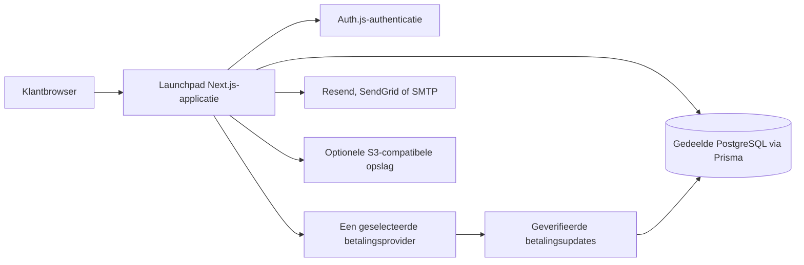

# Launchpad — een complete SaaS-productbasis

**Start een SaaS-product zonder de kernsystemen zelf vanaf nul samen te stellen.**

Launchpad is een complete basis voor SaaS-producten: één samenhangende
Next.js-codebase en een gedeeld PostgreSQL-datamodel voor betalingen,
authenticatie, analytics, beheer, klantwerkruimten, content en optionele
productmogelijkheden. Het is gemaakt voor teams die controle willen houden
over hun applicatie en infrastructuur, in plaats van afhankelijk te zijn van
een gehoste dienst of een verzameling afzonderlijk uitgerolde services.

> Launchpad bevat op productiegebruik gerichte beheer- en beveiligingsfuncties,
> maar maakt een product niet vanzelf productieklaar. Je blijft zelf
> verantwoordelijk voor providerconfiguratie, het beveiligen van de deployment,
> operationele monitoring en productspecifieke juridische en
> beveiligingsbeoordelingen.

[Bekijk Launchpad op Gumroad](https://shehroz2009.gumroad.com/l/launchpad-full-scale-saas-foundation)

Lees deze README in een andere taal:
[العربية](./README.ar.md) · [বাংলা](./README.bn.md) · [Deutsch](./README.de.md) ·
[Español](./README.es.md) · [Français](./README.fr.md) · [हिन्दी](./README.hi.md) ·
[Bahasa Indonesia](./README.id.md) · [Italiano](./README.it.md) ·
[日本語](./README.ja.md) · [한국어](./README.ko.md) · [Polski](./README.pl.md) ·
[Português](./README.pt.md) · [Русский](./README.ru.md) · [Türkçe](./README.tr.md) ·
[Tiếng Việt](./README.vi.md) · [简体中文](./README.zh.md) · [English](../README.md)

## Productvoorbeeld


| Klantwerkruimte | Prijspagina |
| --------------- | ----------- |
|  |  |

Bekijk de [Engelse productscreenshots](../screenshots/) of ontdek de
gelokaliseerde landings- en prijspagina's voor [alle 18 talen](../docs/FEATURES.md#localization).

## Wat Launchpad bevat

- **Klantaccounts:** gelokaliseerde e-mailaanmelding, optionele Google/GitHub
  OAuth, beveiligde routes, TOTP-meervoudige verificatie en herstelcodes.
- **Facturering:** abonnementen en eenmalige Lifetime-aankopen via Stripe,
  Paddle, Lemon Squeezy of PayPro Global, plus optionele verificatie van
  aankopen via Apple App Store / Google Play. Factureringsgebeurtenissen kunnen
  ook optionele uitnodigingen voor privé-GitHub-repositories en het intrekken
  van toegang aansturen.
- **Beheer:** op rollen gebaseerde toegang voor gebruikers, beveiliging,
  analytics, integraties, content, support en ingeschakelde modules.
- **Productwerkruimte:** accountinstellingen, meldingen, support,
  factureringsgeschiedenis en optionele organisatie- en samenwerkingsfuncties.
- **Productmogelijkheden:** optionele modules voor e-mailcampagnes, AI,
  publicatie, marketing, opslag, community, verwijzingen en meer.
- **Operations:** eerste configuratie, projectupdates en begeleide deployment
  naar zes doelen: Vercel + Neon, Docker / cloud-VM, Fly.io, Google Cloud Run,
  AWS ECS Fargate en Kubernetes.

Voor providerafhankelijke mogelijkheden heb je eigen provideraccounts,
inloggegevens en configuratie nodig. De installatiewizard test geselecteerde
gegevens; deploymentworkflows kunnen ondersteunde resources aanmaken in
gekoppelde accounts. Ze maken geen provideraccounts aan en nemen niet weg dat
je doelplatformspecifieke vereisten moet voorbereiden, toestemming moet geven,
kosten moet beoordelen en productiebevoegdheden moet controleren.

Bekijk de [functiematrix](../docs/FEATURES.md) en de uitgebreide
[implementatie- en operationele handleiding](../docs/FEATURE-GUIDE.md) voor de
huidige scope, vereisten en beperkingen.

## Applicatieopbouw



De applicatie gebruikt modulaire grenzen binnen één deploybare codebase.
Geselecteerde modules hergebruiken dezelfde applicatie- en
database-infrastructuur; de modulekeuze maakt er geen onafhankelijke services
of databases van.

## Technologie

| Onderdeel | Technologie |
| --------- | ----------- |
| Applicatie | Next.js 16, React 19, TypeScript |
| Styling | Tailwind CSS 4, herbruikbare shadcn/ui-compatibele componenten |
| Authenticatie | Auth.js, e-maillinks, optionele Google/GitHub OAuth |
| Data | PostgreSQL, Prisma |
| Betalingen | Stripe, Paddle, Lemon Squeezy of PayPro Global; optionele verificatie via Apple App Store en Google Play |
| Kwaliteit | ESLint, Prettier, TypeScript-controles, geautomatiseerde tests |
| Deployment | GitHub Actions-controles; begeleide deployment naar zes ondersteunde doelen |

## Lokaal starten

Je hebt Git, npm, Node.js 20.19+ (of 22.13+/24+) en Docker Desktop met een
actieve daemon nodig. De wizard voor de eerste start gebruikt Docker voor de
lokale database en e-mailinbox.

Kloon de repository en start Launchpad vanuit de projectmap:

```bash
git clone https://github.com/Shehroz2009/Launchpad.git
cd Launchpad
npm run dev
```

Bij de eerste start opent de browser de installatiewizard. Kies de gewenste
functies en services; de wizard installeert de bijbehorende dependencies,
start de meegeleverde PostgreSQL- en Mailpit-containers, voert de eerste
migraties uit, maakt het beheerdersaccount aan en start de applicatie. Een
aparte `npm install`, bewerking van `.env` of migratieopdracht is niet nodig.

Open in de draaiende applicatie **Admin → Integrations** en
**Admin → Deployment** om providers te configureren en een deployment te
starten. Deze workflows vereisen eigen provideraccounts en inloggegevens; de
resources die worden aangemaakt, hangen af van het gekozen doel en deploymentplan.
Bekijk de [quickstart](../docs/QUICKSTART.md) en de
[deploymenthandleiding](../docs/VERCEL.md) voor vereisten en beperkingen.

## Documentatie

- [Quickstart en configuratie](../docs/QUICKSTART.md)
- [Functiematrix en huidige scope](../docs/FEATURES.md)
- [Implementatie- en operationele handleiding](../docs/FEATURE-GUIDE.md)
- [Vercel-deploymentchecklist](../docs/VERCEL.md)
- [Productscreenshots](../screenshots/)

## Licentie en aankoop

Launchpad is gelicentieerde software voor het ontwikkelen en exploiteren van
één product of dienst. De licentie staat niet toe Launchpad of de broncode
ervan opnieuw te verspreiden. Launchpad wordt regelmatig bijgewerkt. De
huidige toegangsopties en aankoopvoorwaarden staan op de
[Gumroad-productpagina](https://shehroz2009.gumroad.com/l/launchpad-full-scale-saas-foundation).
Launchpad is applicatiesoftware die je zelf host en beheert, geen gehoste
SaaS-dienst; hosting- en externe providerkosten zijn apart. Bekijk de
licentievoorwaarden in het meegeleverde [LICENSE](../LICENSE)-bestand.
