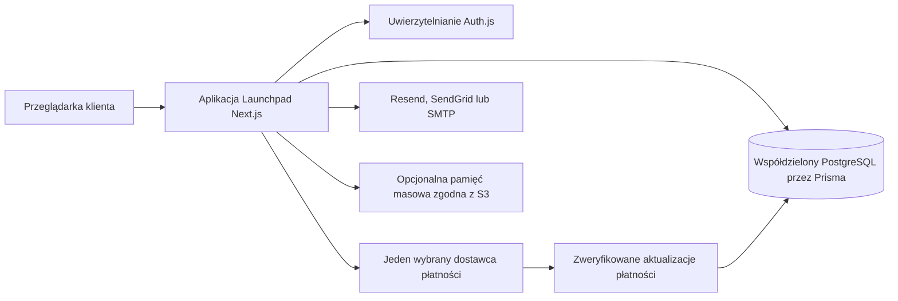

# Launchpad — kompleksowa podstawa produktu SaaS

**Uruchom produkt SaaS bez składania jego podstawowych systemów od zera.**

Launchpad to kompleksowa podstawa produktu SaaS: jedna spójna baza kodu Next.js
i wspólny model danych PostgreSQL obsługujący płatności, uwierzytelnianie,
analitykę, administrację, przestrzenie klientów, treści i opcjonalne
możliwości produktu. Powstał z myślą o zespołach, które chcą kontrolować
aplikację i infrastrukturę, zamiast korzystać z hostowanej usługi lub zestawu
niezależnie wdrażanych serwisów.

> Launchpad zawiera funkcje administracyjne i zabezpieczenia przeznaczone do
> środowisk produkcyjnych, ale sam nie zapewnia gotowości produktu do produkcji.
> Odpowiadasz za konfigurację dostawców, wzmocnienie zabezpieczeń wdrożenia,
> monitoring operacyjny oraz ocenę prawną i bezpieczeństwa konkretnego produktu.

[Zobacz Launchpad w Gumroad](https://shehroz2009.gumroad.com/l/launchpad-full-scale-saas-foundation)

Przeczytaj ten README w innym języku:
[العربية](./README.ar.md) · [বাংলা](./README.bn.md) · [Deutsch](./README.de.md) ·
[Español](./README.es.md) · [Français](./README.fr.md) · [हिन्दी](./README.hi.md) ·
[Bahasa Indonesia](./README.id.md) · [Italiano](./README.it.md) ·
[日本語](./README.ja.md) · [한국어](./README.ko.md) · [Nederlands](./README.nl.md) ·
[Português](./README.pt.md) · [Русский](./README.ru.md) · [Türkçe](./README.tr.md) ·
[Tiếng Việt](./README.vi.md) · [简体中文](./README.zh.md) · [English](../README.md)

## Podgląd produktu


| Przestrzeń klienta | Cennik |
| ------------------ | ------ |
|  |  |

Zobacz [angielskie zrzuty ekranu produktu](../screenshots/) lub poznaj
zlokalizowane strony główne i cenniki w [wszystkich 18 językach](../docs/FEATURES.md#localization).

## Co zawiera Launchpad

- **Konta klientów:** zlokalizowane logowanie e-mailem, opcjonalne Google/GitHub
  OAuth, chronione trasy, uwierzytelnianie wieloskładnikowe TOTP i kody odzyskiwania.
- **Rozliczenia:** subskrypcje i jednorazowe zakupy Lifetime przez Stripe,
  Paddle, Lemon Squeezy lub PayPro Global, a także opcjonalna weryfikacja zakupów
  Apple App Store / Google Play. Zdarzenia rozliczeniowe mogą również obsługiwać
  opcjonalne zaproszenia do prywatnych repozytoriów GitHub i odbieranie dostępu.
- **Administracja:** kontrola dostępu oparta na rolach dla użytkowników,
  bezpieczeństwa, analityki, integracji, treści, wsparcia i włączonych modułów.
- **Przestrzeń produktu:** ustawienia konta, powiadomienia, wsparcie, historia
  rozliczeń oraz opcjonalne funkcje organizacji i współpracy.
- **Funkcje produktu:** opcjonalne moduły kampanii e-mailowych, AI, publikacji,
  marketingu, pamięci masowej, społeczności, poleceń i nie tylko.
- **Operacje:** konfiguracja początkowa, aktualizacje projektu i prowadzone
  wdrożenia na sześciu platformach: Vercel + Neon, Docker / maszyna wirtualna w
  chmurze, Fly.io, Google Cloud Run, AWS ECS Fargate i Kubernetes.

Funkcje oparte na dostawcach wymagają własnych kont, danych uwierzytelniających
i konfiguracji. Kreator konfiguracji testuje wybrane dane, a procesy wdrażania
mogą tworzyć obsługiwane zasoby na połączonych kontach. Nie tworzą one kont
dostawców i nie zwalniają z przygotowania wymagań platformy docelowej,
udzielenia zgód, sprawdzenia kosztów ani weryfikacji uprawnień produkcyjnych.

Aktualny zakres, wymagania i ograniczenia opisują
[macierz funkcji](../docs/FEATURES.md) oraz szczegółowy
[przewodnik po implementacji i operacjach](../docs/FEATURE-GUIDE.md).

## Struktura aplikacji



Aplikacja wykorzystuje granice modułów w ramach jednej wdrażalnej bazy kodu.
Wybrane moduły współdzielą infrastrukturę aplikacji i bazy danych; ich wybór
nie zmienia ich w niezależne usługi ani bazy danych.

## Technologie

| Obszar | Technologia |
| ------ | ----------- |
| Aplikacja | Next.js 16, React 19, TypeScript |
| Style | Tailwind CSS 4, wielokrotnego użytku komponenty zgodne z shadcn/ui |
| Uwierzytelnianie | Auth.js, linki e-mail, opcjonalne Google/GitHub OAuth |
| Dane | PostgreSQL, Prisma |
| Płatności | Stripe, Paddle, Lemon Squeezy lub PayPro Global; opcjonalna weryfikacja Apple App Store i Google Play |
| Jakość | ESLint, Prettier, kontrole TypeScript, testy automatyczne |
| Wdrażanie | Kontrole GitHub Actions; prowadzone wdrożenia na sześciu obsługiwanych platformach |

## Uruchomienie lokalne

Potrzebujesz Git, npm, Node.js 20.19+ (lub 22.13+/24+) oraz uruchomionego
Docker Desktop z działającym demonem. Kreator pierwszego uruchomienia używa
Dockera dla lokalnej bazy danych i skrzynki pocztowej.

Sklonuj repozytorium i uruchom Launchpad z katalogu projektu:

```bash
git clone https://github.com/Shehroz2009/Launchpad.git
cd Launchpad
npm run dev
```

Przy pierwszym uruchomieniu przeglądarka otworzy kreator konfiguracji. Wybierz
potrzebne funkcje i usługi; kreator zainstaluje ich zależności, uruchomi
dołączone kontenery PostgreSQL i Mailpit, zastosuje początkowe migracje,
utworzy konto administratora i uruchomi aplikację. Nie trzeba osobno
uruchamiać `npm install`, edytować `.env` ani polecenia migracji.

Po uruchomieniu aplikacji użyj **Admin → Integracje** i **Admin → Wdrażanie**,
aby skonfigurować dostawców i rozpocząć wdrożenie. Te procesy wymagają własnych
kont i danych uwierzytelniających; tworzone zasoby zależą od wybranej platformy
i planu wdrożenia. Wymagania wstępne i ograniczenia opisują
[przewodnik szybkiego startu](../docs/QUICKSTART.md) oraz
[przewodnik wdrażania](../docs/VERCEL.md).

## Dokumentacja

- [Szybki start i konfiguracja](../docs/QUICKSTART.md)
- [Macierz funkcji i aktualny zakres](../docs/FEATURES.md)
- [Przewodnik po implementacji i operacjach](../docs/FEATURE-GUIDE.md)
- [Lista kontrolna wdrożenia na Vercel](../docs/VERCEL.md)
- [Zrzuty ekranu produktu](../screenshots/)

## Licencja i zakup

Launchpad to licencjonowane oprogramowanie do tworzenia i prowadzenia jednego
produktu lub usługi. Licencja nie zezwala na redystrybucję Launchpad ani jego
kodu źródłowego. Launchpad jest regularnie aktualizowany. Aktualne opcje
dostępu i warunki zakupu znajdują się na
[stronie produktu w Gumroad](https://shehroz2009.gumroad.com/l/launchpad-full-scale-saas-foundation).
Launchpad jest aplikacją, którą samodzielnie hostujesz i obsługujesz, a nie
hostowaną usługą SaaS; opłaty za hosting i usługi dostawców zewnętrznych są
naliczane osobno. Warunki licencji znajdziesz w dołączonym pliku
[LICENSE](../LICENSE).
