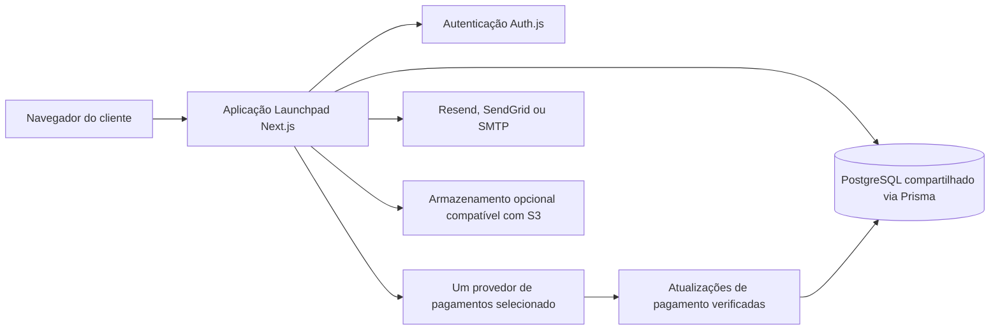

# Launchpad — uma base completa para SaaS

**Lance um produto SaaS sem precisar montar os sistemas essenciais do zero.**

O Launchpad é uma base completa para produtos SaaS: uma única aplicação Next.js
e um modelo de dados PostgreSQL compartilhado para pagamentos, autenticação,
análises, administração, espaços de trabalho dos clientes, conteúdo e
funcionalidades opcionais. Foi desenvolvido para equipes que querem controlar
a aplicação e a infraestrutura — não usar um serviço hospedado por terceiros
nem manter vários serviços implantados separadamente.

> O Launchpad inclui recursos de administração e segurança voltados à produção,
> mas não torna um produto pronto para produção automaticamente. Você continua
> responsável por configurar provedores, reforçar a segurança da implantação,
> monitorar as operações e realizar a análise jurídica e de segurança
> específica do seu produto.

[Veja o Launchpad no Gumroad](https://shehroz2009.gumroad.com/l/launchpad-full-scale-saas-foundation)

Leia este README em outros idiomas:
[العربية](./README.ar.md) · [বাংলা](./README.bn.md) · [Deutsch](./README.de.md) ·
[Español](./README.es.md) · [Français](./README.fr.md) · [हिन्दी](./README.hi.md) ·
[Bahasa Indonesia](./README.id.md) · [Italiano](./README.it.md) ·
[日本語](./README.ja.md) · [한국어](./README.ko.md) · [Nederlands](./README.nl.md) ·
[Polski](./README.pl.md) · [Русский](./README.ru.md) · [Türkçe](./README.tr.md) ·
[Tiếng Việt](./README.vi.md) · [简体中文](./README.zh.md) · [English](../README.md)

## Prévia do produto


| Espaço de trabalho do cliente | Página de preços |
| ----------------------------- | ---------------- |
|  |  |

Veja as [capturas de tela do produto em inglês](../screenshots/) ou explore as
páginas localizadas de apresentação e preços para [todos os 18 idiomas](../docs/FEATURES.md#localization).

## O que o Launchpad inclui

- **Contas de clientes:** login por e-mail localizado, OAuth opcional do
  Google/GitHub, rotas protegidas, autenticação multifator TOTP e códigos de
  recuperação.
- **Cobrança:** assinaturas e compras únicas Lifetime com Stripe, Paddle,
  Lemon Squeezy ou PayPro Global, além de verificação opcional de compras na
  Apple App Store e Google Play. Eventos de cobrança também podem controlar
  convites e remoção de acesso em repositórios privados do GitHub.
- **Administração:** controles protegidos por função para usuários, segurança,
  análises, integrações, conteúdo, suporte e módulos ativados.
- **Espaço de trabalho do produto:** configurações de conta, notificações,
  suporte, histórico de cobranças e recursos opcionais de organizações e
  colaboração.
- **Recursos do produto:** módulos opcionais para campanhas de e-mail, IA,
  publicação, marketing, armazenamento, comunidade, indicações e muito mais.
- **Operações:** configuração inicial, atualizações do projeto e implantação
  guiada em seis destinos: Vercel + Neon, Docker / VM na nuvem, Fly.io,
  Google Cloud Run, AWS ECS Fargate e Kubernetes.

Os recursos que dependem de provedores exigem contas, credenciais e
configuração próprias. O assistente de configuração testa as credenciais
selecionadas, e os fluxos de implantação podem provisionar recursos compatíveis
nas contas conectadas. Eles não criam contas de provedores nem dispensam a
preparação dos pré-requisitos específicos do destino, a concessão de
autorizações, a análise de custos ou a verificação de permissões de produção.

Consulte a [matriz de recursos](../docs/FEATURES.md) e o detalhado
[guia de implementação e operações](../docs/FEATURE-GUIDE.md) para conhecer o
escopo, os requisitos e as limitações atuais.

## Estrutura da aplicação



A aplicação usa limites modulares dentro de uma única base de código
implantável. Os módulos selecionados reutilizam a mesma infraestrutura da
aplicação e do banco de dados; a seleção de módulos não os transforma em
serviços nem bancos de dados independentes.

## Tecnologias

| Área | Tecnologia |
| ---- | ---------- |
| Aplicação | Next.js 16, React 19, TypeScript |
| Estilos | Tailwind CSS 4, componentes reutilizáveis compatíveis com shadcn/ui |
| Autenticação | Auth.js, links por e-mail, OAuth opcional do Google/GitHub |
| Dados | PostgreSQL, Prisma |
| Pagamentos | Stripe, Paddle, Lemon Squeezy ou PayPro Global; verificação opcional da Apple App Store e Google Play |
| Qualidade | ESLint, Prettier, verificações de TypeScript, testes automatizados |
| Implantação | Verificações do GitHub Actions; implantação guiada em seis destinos compatíveis |

## Começar localmente

Você precisa de Git, npm, Node.js 20.19+ (ou 22.13+/24+) e Docker Desktop
iniciado com o daemon em execução. O assistente da primeira execução usa o
Docker para o banco de dados local e a caixa de entrada de e-mail.

Clone o repositório e inicie o Launchpad na pasta do projeto:

```bash
git clone https://github.com/Shehroz2009/Launchpad.git
cd Launchpad
npm run dev
```

Na primeira inicialização, o navegador abre o assistente de configuração.
Escolha os recursos e serviços desejados; o assistente instala as dependências
selecionadas, inicia os contêineres incluídos de PostgreSQL e Mailpit, aplica
as migrações iniciais, cria a conta de administrador e inicia a aplicação. Não
é necessário executar `npm install` separadamente, editar `.env` nem rodar
migrações manualmente.

Depois que a aplicação estiver em execução, use **Administração → Integrações**
e **Administração → Implantação** para configurar provedores e iniciar uma
implantação. Esses fluxos exigem suas próprias contas e credenciais; os
recursos criados dependem do destino e do plano de implantação selecionados.
Consulte o [guia rápido](../docs/QUICKSTART.md) e o
[guia de implantação](../docs/VERCEL.md) para ver os pré-requisitos e as
limitações.

## Documentação

- [Guia rápido e configuração](../docs/QUICKSTART.md)
- [Matriz de recursos e escopo atual](../docs/FEATURES.md)
- [Guia de implementação e operações](../docs/FEATURE-GUIDE.md)
- [Lista de verificação de implantação na Vercel](../docs/VERCEL.md)
- [Capturas de tela do produto](../screenshots/)

## Licença e compra

O Launchpad é um software licenciado para desenvolver e operar um produto ou
serviço. A licença não permite redistribuir o Launchpad nem seu código-fonte.
O Launchpad recebe atualizações regularmente. As opções atuais de acesso e as
condições de compra estão na
[página do produto no Gumroad](https://shehroz2009.gumroad.com/l/launchpad-full-scale-saas-foundation).
O Launchpad é um aplicativo que você hospeda e opera, não um serviço SaaS
hospedado; os custos de hospedagem e de provedores terceirizados são cobrados
à parte. Consulte os termos da licença no [arquivo LICENSE](../LICENSE).
