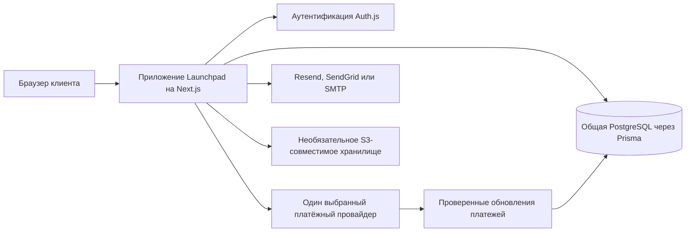

# Launchpad — основа для SaaS-продукта полного цикла

**Запустите SaaS-продукт без сборки основных систем с нуля.**

Launchpad — это полноценная основа для SaaS-продукта: единая кодовая база
Next.js и общая модель данных PostgreSQL для платежей, аутентификации,
аналитики, администрирования, рабочих пространств клиентов, контента и
дополнительных возможностей продукта. Она предназначена для команд, которым
важен контроль над приложением и инфраструктурой, а не размещённый сторонним
поставщиком сервис или набор независимо развёртываемых служб.

> Launchpad включает ориентированные на production административные функции и
> средства безопасности, но сам по себе не делает продукт готовым к запуску.
> Вы отвечаете за настройку провайдеров, усиление защиты развёртывания,
> операционный мониторинг, а также юридическую и безопасностную проверку
> конкретного продукта.

[Посмотреть Launchpad на Gumroad](https://shehroz2009.gumroad.com/l/launchpad-full-scale-saas-foundation)

Читайте этот README на других языках:
[العربية](./README.ar.md) · [বাংলা](./README.bn.md) · [Deutsch](./README.de.md) ·
[Español](./README.es.md) · [Français](./README.fr.md) · [हिन्दी](./README.hi.md) ·
[Bahasa Indonesia](./README.id.md) · [Italiano](./README.it.md) ·
[日本語](./README.ja.md) · [한국어](./README.ko.md) · [Nederlands](./README.nl.md) ·
[Polski](./README.pl.md) · [Português](./README.pt.md) · [Türkçe](./README.tr.md) ·
[Tiếng Việt](./README.vi.md) · [简体中文](./README.zh.md) · [English](../README.md)

## Обзор продукта


| Рабочее пространство клиента | Страница тарифов |
| ----------------------------- | ---------------- |
|  |  |

Посмотрите [скриншоты продукта на английском](../screenshots/) или изучите
локализованные страницы сайта и тарифов для [всех 18 локалей](../docs/FEATURES.md#localization).

## Что входит в Launchpad

- **Учётные записи клиентов:** локализованный вход по электронной почте,
  необязательный OAuth через Google/GitHub, защищённые маршруты,
  многофакторная аутентификация TOTP и коды восстановления.
- **Биллинг:** подписки и разовые покупки Lifetime через Stripe, Paddle,
  Lemon Squeezy или PayPro Global, а также необязательная проверка покупок в
  Apple App Store и Google Play. События биллинга также могут управлять
  приглашениями в приватные репозитории GitHub и отзывом доступа.
- **Администрирование:** защищённые ролями инструменты управления
  пользователями, безопасностью, аналитикой, интеграциями, контентом,
  поддержкой и включёнными модулями.
- **Рабочее пространство продукта:** настройки учётной записи, уведомления,
  поддержка, история платежей и необязательные функции организаций и
  совместной работы.
- **Функции продукта:** необязательные модули для email-кампаний, ИИ,
  публикаций, маркетинга, хранилища, сообщества, реферальных программ и не
  только.
- **Эксплуатация:** первичная настройка, обновление проектов и управляемое
  развёртывание на шести платформах: Vercel + Neon, Docker / облачная VM,
  Fly.io, Google Cloud Run, AWS ECS Fargate и Kubernetes.

Для функций, зависящих от провайдеров, нужны собственные учётные записи,
ключи доступа и настройки. Мастер настройки проверяет выбранные учётные
данные, а процессы развёртывания могут создавать поддерживаемые ресурсы в
подключённых аккаунтах. Они не создают аккаунты провайдеров и не отменяют
необходимость подготовить требования выбранной платформы, предоставить
согласия, проверить стоимость и подтвердить production-разрешения.

Актуальные сведения о возможностях, требованиях и ограничениях см. в
[таблице функций](../docs/FEATURES.md) и подробном
[руководстве по реализации и эксплуатации](../docs/FEATURE-GUIDE.md).

## Архитектура приложения



Приложение использует модульные границы внутри одной кодовой базы, которую
можно развёртывать как единое целое. Выбранные модули используют общую
инфраструктуру приложения и базы данных; выбор модулей не превращает их в
отдельные службы или базы данных.

## Технологии

| Область | Технологии |
| ------- | ---------- |
| Приложение | Next.js 16, React 19, TypeScript |
| Стили | Tailwind CSS 4, переиспользуемые компоненты, совместимые с shadcn/ui |
| Аутентификация | Auth.js, вход по ссылке из письма, необязательный OAuth Google/GitHub |
| Данные | PostgreSQL, Prisma |
| Платежи | Stripe, Paddle, Lemon Squeezy или PayPro Global; необязательная проверка покупок Apple App Store и Google Play |
| Качество | ESLint, Prettier, проверки TypeScript, автоматизированные тесты |
| Развёртывание | Проверки GitHub Actions; управляемое развёртывание на шести поддерживаемых платформах |

## Локальный запуск

Вам понадобятся Git, npm, Node.js 20.19+ (или 22.13+/24+) и запущенный
Docker Desktop с работающим демоном. Мастер первого запуска использует Docker
для локальной базы данных и почтового тестового ящика.

Клонируйте репозиторий и запустите Launchpad из папки проекта:

```bash
git clone https://github.com/Shehroz2009/Launchpad.git
cd Launchpad
npm run dev
```

При первом запуске браузер откроет мастер настройки. Выберите нужные функции
и сервисы: мастер установит их зависимости, запустит контейнеры встроенных
PostgreSQL и Mailpit, применит начальные миграции, создаст учётную запись
администратора и запустит приложение. Отдельно выполнять `npm install`,
редактировать `.env` или запускать миграции не требуется.

После запуска приложения откройте **Администрирование → Интеграции** и
**Администрирование → Развёртывание**, чтобы настроить провайдеров и начать
развёртывание. Для этих процессов нужны ваши учётные записи провайдеров и
ключи доступа; создаваемые ресурсы зависят от выбранной платформы и плана
развёртывания. Требования и ограничения приведены в
[кратком руководстве](../docs/QUICKSTART.md) и
[руководстве по развёртыванию](../docs/VERCEL.md).

## Документация

- [Краткое руководство и настройка](../docs/QUICKSTART.md)
- [Таблица функций и актуальный охват](../docs/FEATURES.md)
- [Руководство по реализации и эксплуатации](../docs/FEATURE-GUIDE.md)
- [Контрольный список развёртывания в Vercel](../docs/VERCEL.md)
- [Скриншоты продукта](../screenshots/)

## Лицензия и покупка

Launchpad — лицензируемое программное обеспечение для разработки и
эксплуатации одного продукта или сервиса. Лицензия не разрешает
распространять Launchpad или его исходный код. Проект регулярно обновляется.
Актуальные варианты доступа и условия покупки указаны на
[странице продукта в Gumroad](https://shehroz2009.gumroad.com/l/launchpad-full-scale-saas-foundation).
Launchpad — приложение, которое вы размещаете и обслуживаете самостоятельно,
а не размещённый SaaS-сервис; расходы на хостинг и сторонних провайдеров
оплачиваются отдельно. Условия лицензии приведены в прилагаемом
[файле LICENSE](../LICENSE).
