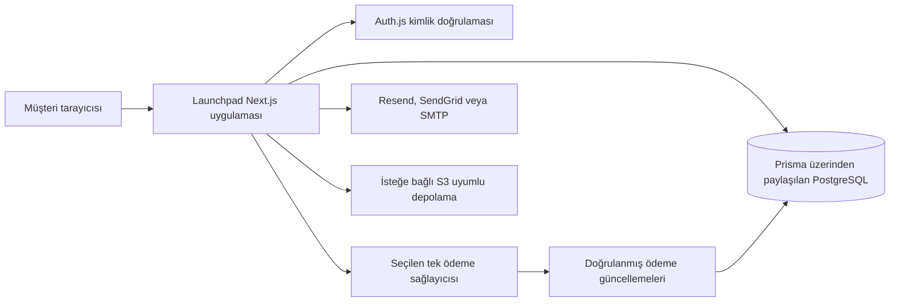

# Launchpad — Kapsamlı SaaS Ürün Temeli

**Temel sistemleri sıfırdan bir araya getirmeden SaaS ürününüzü başlatın.**

Launchpad; ödemeler, kimlik doğrulama, analiz, yönetim, müşteri çalışma
alanları, içerik ve isteğe bağlı ürün yetenekleri için tek bir Next.js kod
tabanını ve paylaşılan PostgreSQL veri modelini bir araya getiren kapsamlı bir
SaaS ürün temelidir. Barındırılan bir hizmete veya birbirinden ayrı dağıtılan
servis koleksiyonuna bağlı kalmadan uygulaması ve altyapısı üzerinde denetim
sahibi olmak isteyen ekipler için geliştirilmiştir.

> Launchpad, üretime yönelik yönetim ve güvenlik özellikleri içerir; ancak
> ürünü tek başına üretime hazır hâle getirmez. Sağlayıcı yapılandırması,
> dağıtım güvenliğinin güçlendirilmesi, operasyonel izleme ve ürüne özgü hukuk
> ve güvenlik incelemeleri sizin sorumluluğunuzdadır.

[Gumroad'da Launchpad'i görüntüleyin](https://shehroz2009.gumroad.com/l/launchpad-full-scale-saas-foundation)

Bu README'yi diğer dillerde okuyun:
[العربية](./README.ar.md) · [বাংলা](./README.bn.md) · [Deutsch](./README.de.md) ·
[Español](./README.es.md) · [Français](./README.fr.md) · [हिन्दी](./README.hi.md) ·
[Bahasa Indonesia](./README.id.md) · [Italiano](./README.it.md) ·
[日本語](./README.ja.md) · [한국어](./README.ko.md) · [Nederlands](./README.nl.md) ·
[Polski](./README.pl.md) · [Português](./README.pt.md) · [Русский](./README.ru.md) ·
[Tiếng Việt](./README.vi.md) · [简体中文](./README.zh.md) · [English](../README.md)

## Ürün önizlemesi


| Müşteri çalışma alanı | Fiyatlandırma |
| --------------------- | ------------- |
|  |  |

[İngilizce ürün ekran görüntülerine](../screenshots/) göz atın veya [18 dilin
tamamındaki](../docs/FEATURES.md#localization) yerelleştirilmiş açılış ve
fiyatlandırma sayfalarını inceleyin.

## Launchpad neler içerir?

- **Müşteri hesapları:** yerelleştirilmiş e-posta girişi, isteğe bağlı
  Google/GitHub OAuth, korumalı rotalar, TOTP çok faktörlü kimlik doğrulama ve
  kurtarma kodları.
- **Faturalandırma:** abonelikler ve tek seferlik Lifetime satın alımları için
  Stripe, Paddle, Lemon Squeezy veya PayPro Global; ayrıca isteğe bağlı Apple
  App Store / Google Play satın alma doğrulaması. Faturalandırma olayları,
  isteğe bağlı GitHub depo davetlerini ve erişim kaldırmayı da yönetebilir.
- **Yönetim:** kullanıcılar, güvenlik, analizler, entegrasyonlar, içerik,
  destek ve etkin modüller için rolle korunan kontroller.
- **Ürün çalışma alanı:** hesap ayarları, bildirimler, destek, faturalandırma
  geçmişi ve isteğe bağlı kuruluş ve iş birliği özellikleri.
- **Ürün yetenekleri:** e-posta kampanyaları, yapay zekâ, yayınlama, pazarlama,
  depolama, topluluk, yönlendirmeler ve daha fazlası için isteğe bağlı modüller.
- **Operasyonlar:** ilk kurulum, proje güncellemeleri ve altı hedefe yönelik
  kılavuzlu dağıtım: Vercel + Neon, Docker / Bulut VM, Fly.io, Google Cloud Run,
  AWS ECS Fargate ve Kubernetes.

Sağlayıcılara bağlı özellikler için kendi sağlayıcı hesaplarınız, kimlik
bilgileriniz ve yapılandırmanız gerekir. Kurulum sihirbazı seçilen kimlik
bilgilerini sınar; dağıtım iş akışları da bağlı hesaplarda desteklenen
kaynakları oluşturabilir. Bu iş akışları sağlayıcı hesabı oluşturmaz; hedefe
özgü ön koşulları hazırlama, onay verme, maliyetleri inceleme ve production
izinlerini doğrulama sorumluluğu sizdedir.

Güncel kapsam, gereksinimler ve sınırlamalar için [özellik matrisine](../docs/FEATURES.md)
ve ayrıntılı [uygulama ve operasyon kılavuzuna](../docs/FEATURE-GUIDE.md) bakın.

## Uygulama mimarisi



Uygulama, tek bir dağıtılabilir kod tabanı içinde modüler sınırlar kullanır.
Seçilen modüller aynı uygulama ve veritabanı altyapısını paylaşır; modül
seçimi bunları bağımsız servislere veya veritabanlarına dönüştürmez.

## Teknoloji

| Alan | Teknoloji |
| ---- | --------- |
| Uygulama | Next.js 16, React 19, TypeScript |
| Stil | Tailwind CSS 4, shadcn/ui ile uyumlu yeniden kullanılabilir bileşenler |
| Kimlik doğrulama | Auth.js, e-posta bağlantıları, isteğe bağlı Google/GitHub OAuth |
| Veri | PostgreSQL, Prisma |
| Ödemeler | Stripe, Paddle, Lemon Squeezy veya PayPro Global; isteğe bağlı Apple App Store ve Google Play doğrulaması |
| Kalite | ESLint, Prettier, TypeScript denetimleri, otomatik testler |
| Dağıtım | GitHub Actions denetimleri; desteklenen altı hedefe kılavuzlu dağıtım |

## Yerel olarak başlatma

Git, npm, Node.js 20.19+ (veya 22.13+/24+) ve daemon'ı çalışan Docker
Desktop gerekir. İlk çalıştırma sihirbazı yerel veritabanı ve e-posta gelen
kutusu için Docker kullanır.

Depoyu klonlayıp Launchpad'i proje dizininden başlatın:

```bash
git clone https://github.com/Shehroz2009/Launchpad.git
cd Launchpad
npm run dev
```

İlk başlatmada tarayıcınızda kurulum sihirbazı açılır. İstediğiniz özellik ve
hizmetleri seçin; sihirbaz bağımlılıklarını kurar, paketle gelen PostgreSQL
ve Mailpit kapsayıcılarını başlatır, ilk Prisma geçişlerini uygular, yönetici
hesabını hazırlar ve uygulamayı çalıştırır. Ayrı bir `npm install`, `.env`
düzenlemesi veya geçiş komutu gerekmez.

Uygulama çalışırken sağlayıcıları yapılandırmak ve dağıtımı başlatmak için
**Yönetici → Entegrasyonlar** ve **Yönetici → Dağıtım** bölümlerini kullanın.
Bu iş akışları kendi sağlayıcı hesaplarınızı ve kimlik bilgilerinizi gerektirir;
oluşturulan kaynaklar seçilen hedefe ve dağıtım planına bağlıdır. Ön koşullar
ve sınırlamalar için [hızlı başlangıç kılavuzuna](../docs/QUICKSTART.md) ve
[dağıtım kılavuzuna](../docs/VERCEL.md) bakın.

## Belgeler

- [Hızlı başlangıç ve yapılandırma](../docs/QUICKSTART.md)
- [Özellik matrisi ve güncel kapsam](../docs/FEATURES.md)
- [Uygulama ve operasyon kılavuzu](../docs/FEATURE-GUIDE.md)
- [Vercel dağıtım kontrol listesi](../docs/VERCEL.md)
- [Ürün ekran görüntüleri](../screenshots/)

## Lisans ve satın alma

Launchpad, tek bir ürün veya hizmet geliştirmek ve işletmek için lisanslanan
yazılımdır. Lisans, Launchpad'i veya kaynak kodunu yeniden dağıtmanıza izin
vermez. Launchpad düzenli olarak güncellenir. Güncel erişim seçenekleri ve
satın alma koşulları
[Gumroad ürün sayfasında](https://shehroz2009.gumroad.com/l/launchpad-full-scale-saas-foundation)
yer alır. Launchpad, barındırılan bir SaaS hizmeti değil, sizin barındırıp
işlettiğiniz bir uygulamadır; barındırma ve üçüncü taraf sağlayıcı ücretleri
ayrıdır. Lisans koşulları için ürünle birlikte gelen [LICENSE](../LICENSE)
dosyasını inceleyin.
