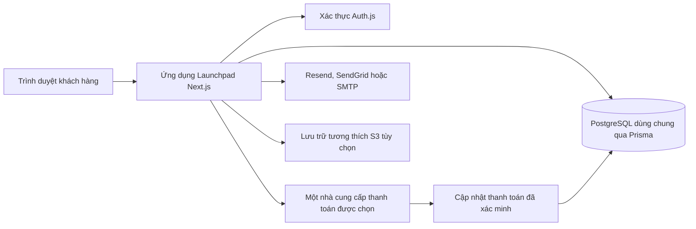

# Launchpad — Nền tảng SaaS toàn diện

**Ra mắt sản phẩm SaaS mà không phải tự lắp ghép các hệ thống cốt lõi từ đầu.**

Launchpad là nền tảng sản phẩm SaaS toàn diện: một mã nguồn Next.js thống nhất
và mô hình dữ liệu PostgreSQL dùng chung cho thanh toán, xác thực, phân tích,
quản trị, không gian làm việc của khách hàng, nội dung và các khả năng sản phẩm
tùy chọn. Nền tảng này dành cho các nhóm muốn kiểm soát ứng dụng và hạ tầng
của mình, thay vì dùng dịch vụ được lưu trữ sẵn hoặc tập hợp các dịch vụ triển
khai riêng biệt.

> Launchpad có các khả năng quản trị và bảo mật hướng đến môi trường production,
> nhưng tự nó không khiến sản phẩm sẵn sàng cho production. Bạn vẫn chịu trách
> nhiệm cấu hình nhà cung cấp, tăng cường bảo mật triển khai, giám sát vận hành
> và đánh giá pháp lý cũng như bảo mật riêng cho sản phẩm của mình.

[Xem Launchpad trên Gumroad](https://shehroz2009.gumroad.com/l/launchpad-full-scale-saas-foundation)

Đọc README này bằng ngôn ngữ khác:
[العربية](./README.ar.md) · [বাংলা](./README.bn.md) · [Deutsch](./README.de.md) ·
[Español](./README.es.md) · [Français](./README.fr.md) · [हिन्दी](./README.hi.md) ·
[Bahasa Indonesia](./README.id.md) · [Italiano](./README.it.md) ·
[日本語](./README.ja.md) · [한국어](./README.ko.md) · [Nederlands](./README.nl.md) ·
[Polski](./README.pl.md) · [Português](./README.pt.md) · [Русский](./README.ru.md) ·
[Türkçe](./README.tr.md) · [简体中文](./README.zh.md) · [English](../README.md)

## Xem trước sản phẩm


| Không gian làm việc khách hàng | Trang giá |
| ------------------------------ | --------- |
|  |  |

Xem [ảnh chụp màn hình sản phẩm bằng tiếng Anh](../screenshots/) hoặc khám phá
các trang giới thiệu và giá đã bản địa hóa cho [đủ 18 ngôn ngữ](../docs/FEATURES.md#localization).

## Launchpad bao gồm những gì

- **Tài khoản khách hàng:** đăng nhập email đã bản địa hóa, OAuth Google/GitHub
  tùy chọn, các tuyến được bảo vệ, xác thực đa yếu tố TOTP và mã khôi phục.
- **Thanh toán:** đăng ký và giao dịch mua Lifetime một lần qua Stripe, Paddle,
  Lemon Squeezy hoặc PayPro Global; đồng thời hỗ trợ xác minh giao dịch mua
  Apple App Store / Google Play tùy chọn. Sự kiện thanh toán cũng có thể quản
  lý lời mời vào kho riêng tư GitHub và việc thu hồi quyền truy cập.
- **Quản trị:** các công cụ kiểm soát theo vai trò cho người dùng, bảo mật,
  phân tích, tích hợp, nội dung, hỗ trợ và mô-đun được bật.
- **Không gian sản phẩm:** cài đặt tài khoản, thông báo, hỗ trợ, lịch sử thanh
  toán và các tính năng tổ chức, cộng tác tùy chọn.
- **Khả năng sản phẩm:** các mô-đun tùy chọn cho chiến dịch email, AI, xuất bản,
  tiếp thị, lưu trữ, cộng đồng, giới thiệu và nhiều tính năng khác.
- **Vận hành:** thiết lập lần đầu, cập nhật dự án và triển khai có hướng dẫn
  đến sáu mục tiêu: Vercel + Neon, Docker / Cloud VM, Fly.io, Google Cloud Run,
  AWS ECS Fargate và Kubernetes.

Các khả năng dựa trên nhà cung cấp cần tài khoản, thông tin xác thực và cấu
hình riêng của bạn. Trình hướng dẫn thiết lập kiểm tra thông tin xác thực được
chọn; quy trình triển khai có thể cấp phát các tài nguyên được hỗ trợ trong
tài khoản đã kết nối. Chúng không tạo tài khoản nhà cung cấp và không thay thế
việc chuẩn bị điều kiện tiên quyết theo mục tiêu, cấp quyền đồng ý, xem xét
chi phí và xác minh quyền production.

Xem [ma trận tính năng](../docs/FEATURES.md) và
[hướng dẫn triển khai và vận hành](../docs/FEATURE-GUIDE.md) để biết phạm vi,
yêu cầu và giới hạn hiện tại.

## Cấu trúc ứng dụng



Ứng dụng dùng các ranh giới mô-đun trong một mã nguồn có thể triển khai thống
nhất. Các mô-đun được chọn dùng chung hạ tầng ứng dụng và cơ sở dữ liệu; việc
chọn mô-đun không biến chúng thành các dịch vụ hay cơ sở dữ liệu độc lập.

## Công nghệ

| Lĩnh vực | Công nghệ |
| -------- | --------- |
| Ứng dụng | Next.js 16, React 19, TypeScript |
| Giao diện | Tailwind CSS 4, các thành phần có thể tái sử dụng tương thích shadcn/ui |
| Xác thực | Auth.js, liên kết email, OAuth Google/GitHub tùy chọn |
| Dữ liệu | PostgreSQL, Prisma |
| Thanh toán | Stripe, Paddle, Lemon Squeezy hoặc PayPro Global; xác minh Apple App Store và Google Play tùy chọn |
| Chất lượng | ESLint, Prettier, kiểm tra TypeScript, kiểm thử tự động |
| Triển khai | Kiểm tra GitHub Actions; triển khai có hướng dẫn đến sáu mục tiêu được hỗ trợ |

## Bắt đầu chạy cục bộ

Bạn cần Git, npm, Node.js 20.19+ (hoặc 22.13+/24+) và Docker Desktop đang
chạy với daemon hoạt động. Trình hướng dẫn lần đầu dùng Docker cho cơ sở dữ
liệu cục bộ và hộp thư kiểm thử.

Sao chép kho mã và khởi động Launchpad từ thư mục dự án:

```bash
git clone https://github.com/Shehroz2009/Launchpad.git
cd Launchpad
npm run dev
```

Trong lần khởi động đầu tiên, trình duyệt sẽ mở trình hướng dẫn thiết lập.
Chọn các tính năng và dịch vụ bạn cần; trình hướng dẫn cài đặt các phần phụ
thuộc đã chọn, khởi động các container PostgreSQL và Mailpit đi kèm, áp dụng
các migration ban đầu, tạo tài khoản quản trị viên và chạy ứng dụng. Không
cần chạy riêng `npm install`, chỉnh sửa `.env` hay lệnh migration.

Khi ứng dụng đang chạy, hãy mở **Admin → Integrations** và
**Admin → Deployment** để cấu hình nhà cung cấp và bắt đầu triển khai. Các quy
trình này cần tài khoản và thông tin xác thực của riêng bạn; tài nguyên được
tạo phụ thuộc vào mục tiêu và kế hoạch triển khai đã chọn. Xem
[hướng dẫn nhanh](../docs/QUICKSTART.md) và
[hướng dẫn triển khai](../docs/VERCEL.md) để biết điều kiện tiên quyết và giới
hạn.

## Tài liệu

- [Hướng dẫn nhanh và cấu hình](../docs/QUICKSTART.md)
- [Ma trận tính năng và phạm vi hiện tại](../docs/FEATURES.md)
- [Hướng dẫn triển khai và vận hành](../docs/FEATURE-GUIDE.md)
- [Danh sách kiểm tra triển khai Vercel](../docs/VERCEL.md)
- [Ảnh chụp màn hình sản phẩm](../screenshots/)

## Giấy phép và mua hàng

Launchpad là phần mềm được cấp phép để phát triển và vận hành một sản phẩm
hoặc dịch vụ. Giấy phép không cho phép phân phối lại Launchpad hoặc mã nguồn
của nó. Launchpad được cập nhật thường xuyên. Các tùy chọn truy cập và điều
khoản mua hiện tại có trên
[trang sản phẩm Gumroad](https://shehroz2009.gumroad.com/l/launchpad-full-scale-saas-foundation).
Launchpad là phần mềm ứng dụng do bạn tự lưu trữ và vận hành, không phải dịch
vụ SaaS được lưu trữ sẵn; phí lưu trữ và nhà cung cấp bên thứ ba được tính
riêng. Xem điều khoản cấp phép trong [LICENSE](../LICENSE).
