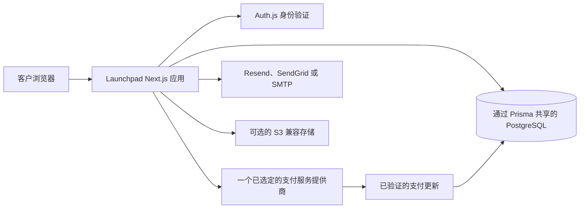

# Launchpad — 全面的 SaaS 产品基础

**无需从零拼装核心系统，即可启动 SaaS 产品。**

Launchpad 是一套全面的 SaaS 产品基础：以统一的 Next.js 代码库和共享的
PostgreSQL 数据模型，提供支付、身份验证、分析、管理、客户工作空间、
内容及可选产品功能。它面向希望掌控自身应用与基础设施的团队，而不是
依赖托管服务或分别部署的一组服务。

> Launchpad 提供面向生产环境的管理与安全能力，但它本身并不能让产品
> 自动达到生产就绪状态。你仍需负责配置服务提供商、强化部署安全、
> 运行监控，以及针对具体产品进行法律与安全审查。

[在 Gumroad 上查看 Launchpad](https://shehroz2009.gumroad.com/l/launchpad-full-scale-saas-foundation)

也可使用以下语言阅读此 README：
[العربية](./README.ar.md) · [বাংলা](./README.bn.md) · [Deutsch](./README.de.md) ·
[Español](./README.es.md) · [Français](./README.fr.md) · [हिन्दी](./README.hi.md) ·
[Bahasa Indonesia](./README.id.md) · [Italiano](./README.it.md) ·
[日本語](./README.ja.md) · [한국어](./README.ko.md) · [Nederlands](./README.nl.md) ·
[Polski](./README.pl.md) · [Português](./README.pt.md) · [Русский](./README.ru.md) ·
[Türkçe](./README.tr.md) · [Tiếng Việt](./README.vi.md) · [English](../README.md)

## 产品预览


| 客户工作空间 | 定价页面 |
| ------------ | -------- |
|  |  |

浏览[英文产品截图](../screenshots/)，或查看[全部 18 种语言](../docs/FEATURES.md#localization)
的本地化首页与定价页面。

## Launchpad 包含的内容

- **客户账户：**本地化的电子邮件登录、可选的 Google/GitHub OAuth、
  受保护的路由、TOTP 多因素身份验证和恢复代码。
- **计费：**通过 Stripe、Paddle、Lemon Squeezy 或 PayPro Global 提供
  订阅和一次性 Lifetime 购买，也可选配 Apple App Store / Google Play
  购买验证。计费事件还可驱动可选的 GitHub 私有仓库邀请和访问权限撤销。
- **管理功能：**按角色保护的用户、安全、分析、集成、内容、支持和已启用
  模块管理工具。
- **产品工作空间：**账户设置、通知、支持、计费历史，以及可选的组织和
  协作功能。
- **产品能力：**用于邮件营销活动、AI、内容发布、营销、存储、社区、
  推荐计划等功能的可选模块。
- **运维：**首次设置、项目更新，以及面向六种目标的引导式部署：
  Vercel + Neon、Docker / 云虚拟机、Fly.io、Google Cloud Run、
  AWS ECS Fargate 和 Kubernetes。

依赖服务提供商的功能需要你自己的服务商账户、凭据和配置。设置向导
可以测试选定的凭据；部署流程可以在已连接的账户中创建受支持的资源。
这些流程不会创建服务提供商账户，也不能免除你准备目标平台前置条件、
授予授权、核查费用和验证生产权限的责任。

有关当前范围、要求和限制，请参阅[功能矩阵](../docs/FEATURES.md)以及详细的
[实现与运维指南](../docs/FEATURE-GUIDE.md)。

## 应用架构



应用在单一可部署代码库中采用模块化边界。已选模块复用同一应用和数据库
基础设施；选择模块不会使它们变成独立服务或数据库。

## 技术

| 领域 | 技术 |
| ---- | ---- |
| 应用 | Next.js 16、React 19、TypeScript |
| 样式 | Tailwind CSS 4、兼容 shadcn/ui 的可复用组件 |
| 身份验证 | Auth.js、邮件登录链接、可选的 Google/GitHub OAuth |
| 数据 | PostgreSQL、Prisma |
| 支付 | Stripe、Paddle、Lemon Squeezy 或 PayPro Global；可选 Apple App Store 和 Google Play 验证 |
| 质量 | ESLint、Prettier、TypeScript 检查、自动化测试 |
| 部署 | GitHub Actions 检查；面向六种受支持目标的引导式部署 |

## 本地启动

需要安装 Git、npm、Node.js 20.19+（或 22.13+/24+），并启动 Docker
Desktop 及其守护进程。首次启动向导使用 Docker 运行本地数据库和邮件收件箱。

克隆代码库并在项目目录中启动 Launchpad：

```bash
git clone https://github.com/Shehroz2009/Launchpad.git
cd Launchpad
npm run dev
```

首次启动时，浏览器会打开设置向导。选择所需的功能和服务后，向导会安装
相应依赖、启动内置 PostgreSQL 和 Mailpit 容器、应用初始迁移、创建管理员
账户并启动应用。无需单独运行 `npm install`、编辑 `.env` 或执行迁移命令。

应用运行后，打开 **Admin → Integrations** 和 **Admin → Deployment** 配置
服务提供商并开始部署。这些流程需要你自己的服务商账户和凭据；创建的
资源取决于所选目标和部署计划。前置条件和限制请参阅
[快速入门](../docs/QUICKSTART.md)和[部署指南](../docs/VERCEL.md)。

## 文档

- [快速入门与配置](../docs/QUICKSTART.md)
- [功能矩阵与当前范围](../docs/FEATURES.md)
- [实现与运维指南](../docs/FEATURE-GUIDE.md)
- [Vercel 部署检查清单](../docs/VERCEL.md)
- [产品截图](../screenshots/)

## 许可与购买

Launchpad 是授权用于开发和运营单个产品或服务的软件。许可证不允许重新
分发 Launchpad 或其源代码。Launchpad 会定期更新。当前访问选项和购买
条款请见 [Gumroad 产品页面](https://shehroz2009.gumroad.com/l/launchpad-full-scale-saas-foundation)。
Launchpad 是由你自行托管和运营的应用软件，而非托管式 SaaS 服务；托管和
第三方服务提供商费用另计。许可条款请参阅随附的 [LICENSE](../LICENSE)。
